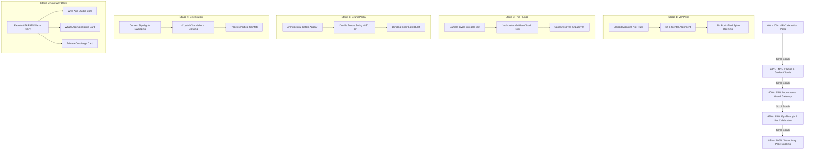
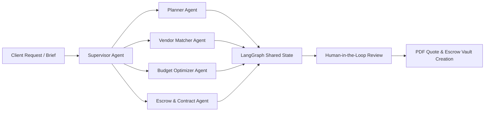

# Eventalogy International — Master Handover & Technical Specification

> **Official Brand Name:** Eventalogy International *(note the "a" in Eventalogy)*  
> **Brand Tagline:** Curating Extraordinary Celebrations Worldwide.  
> **Live Production Website:** [https://eventology-website.vercel.app](https://eventology-website.vercel.app)  
> **Document Purpose:** Single-source master handover documenting all system architecture, repositories, frontends, backends, 3D storytelling scroll implementation, security rules, and next-step roadmap for continuing development in a new thread.

---

## Table of Contents
1. [Executive Summary & Brand Philosophy](#1-executive-summary--brand-philosophy)
2. [Monorepo & Multi-Repository Architecture](#2-monorepo--multi-repository-architecture)
3. [Flagship 3D Storytelling Scroll Hero](#3-flagship-3d-storytelling-scroll-hero)
4. [Marketing & Experience Web Platform (Next.js 15)](#4-marketing--experience-web-platform-nextjs-15)
5. [Cross-Platform Client & Vendor Application (Flutter)](#5-cross-platform-client--vendor-application-flutter)
6. [Autonomous Multi-Agent AI Backend (LangGraph & Node.js)](#6-autonomous-multi-agent-ai-backend-langgraph--nodejs)
7. [Database Schema & Firestore Security Architecture](#7-database-schema--firestore-security-architecture)
8. [Design System & Aesthetics](#8-design-system--aesthetics)
9. [Deployment, Infrastructure & CI/CD](#9-deployment-infrastructure--cicd)
10. [Audit of Completed Work & Recent Fixes](#10-audit-of-completed-work--recent-fixes)
11. [Immediate Action Items & Roadmap for the Next Thread](#11-immediate-action-items--roadmap-for-the-next-thread)

---

## 1. Executive Summary & Brand Philosophy

**Eventalogy International** is an enterprise-grade luxury event curation and multi-agent production platform. Unlike traditional wedding portals or generic directory listings, Eventalogy targets high-net-worth individuals (HNWIs), global corporations, concert promoters, and royalty:
- **Royal & Heritage Celebrations:** Palaces in Rajasthan, French Châteaux, Italian Villas.
- **Stadium & Mega Concerts:** High-voltage sound, automated stage rigging, laser FX, artist hospitality.
- **Corporate & International Summits:** C-suite retreats in Dubai, Davos-style conferences, luxury galas in Monaco.

### Core Value Propositions
1. **Curated Luxury Vendor Ecosystem:** Strict invitation-only vendor vetting; zero spam or unverified bidding.
2. **Milestone-Based Smart Escrow:** Funds are protected in milestone vaults and released strictly upon verified proof-of-work (GPS checks, client sign-offs, photo inspection).
3. **Autonomous AI Production Orchestration:** LangGraph-powered multi-agent system coordinating budget allocation, RFQ generation, venue scheduling, and real-time vendor negotiations.
4. **Cinematic Digital Experience:** Apple-style 3D storytelling scroll hero that immerses the user into the grandeur of an event right from page load ($Y=0$).

---

## 2. Monorepo & Multi-Repository Architecture

The project ecosystem is split cleanly into two local directory structures with dedicated git workflows:

```
d:\Projects\
├── Eventology\                          # Main System Workspace
│   ├── eventology_app\                  # Flutter Multi-Platform App (iOS/Android/Web/Desktop)
│   │   ├── lib\                         # Core, Features, Models, Services, UI
│   │   ├── test\                        # Unit & Widget Test Suites
│   │   ├── firestore.rules              # Production RBAC Database Rules
│   │   └── pubspec.yaml                 # Flutter 3.x Dependencies
│   ├── eventology_backend\              # Node.js + LangGraph AI Microservices
│   │   ├── src\
│   │   │   ├── agents\                  # Autonomous specialized AI agents
│   │   │   ├── graph\                   # LangGraph state machine & workflow graphs
│   │   │   ├── llm\                     # Gemini & OpenAI model adapters
│   │   │   ├── services\                # Razorpay Escrow, Firebase Admin, PDF generation
│   │   │   └── index.ts                 # Express API & webhook entrypoint
│   │   └── package.json                 # Node dependencies
│   ├── eventology_web\                  # Mirrored Web Code (tracked on branch: website)
│   └── architecture_specifications\     # Formal specifications & agent contracts
│
└── Eventology-Website\                  # Production Next.js 15 Landing Platform
    ├── src\
    │   ├── app\                         # Next.js App Router (12 production routes)
    │   ├── components\                  # Reusable UI & Storytelling 3D Engine
    │   │   ├── StorytellingScroll.tsx   # Dynamic client wrapper & skeleton
    │   │   ├── StorytellingScrollInner.tsx # 5-Stage CSS 3D + Three.js Scroll Engine
    │   │   └── scroll\
    │   │       ├── ScrollScrubEngine.ts # Smoothstep & interpolation math
    │   │       └── GatewayDock.tsx      # 3-Card Interactive Entry Portal
    │   └── hooks\                       # Viewport, scroll, and media query hooks
    └── package.json                     # Next 15.1.6, React 19, Tailwind, Three.js
```

### Git Branch Strategy
- **`D:\Projects\Eventology`**:
  - `main`: Tracks the Flutter application, backend services, database rules, and architecture specs. **Never commit raw website files directly to main.**
  - `website`: Dedicated branch mirroring the `eventology_web/` code to ensure backend developers have full website reference without polluting the mobile/backend git log.
- **`D:\Projects\Eventology-Website`**:
  - `master`: Standalone repository deployed to Vercel production (`https://eventology-website.vercel.app`).
  - Remote: `https://github.com/aayush1109-bot/eventology_website.git`.

---

## 3. Flagship 3D Storytelling Scroll Hero

Located in `D:\Projects\Eventology-Website\src\components\StorytellingScrollInner.tsx`, this component executes a cinematic 5-stage scroll journey spanning a `500vh` scrub container.



### Key Technical Innovations in the 3D Engine:
1. **Zero-Offset Hero Placement ($Y=0$):**
   - The scroll track starts at the exact top of the viewport. No static white hero banner pushes the 3D canvas down.
2. **Accurate 3D Book Mechanics:**
   - The card consists of a static Right Page and an animated Left Cover (`transform-origin: left center`).
   - As the cover rotates $-180^\circ$ into open view, the entire container translates along the X-axis by $+50\%$ of the card's half-width to prevent the opened book from lurching to the left.
3. **Hardware Acceleration:**
   - Employs CSS `transform-style: preserve-3d`, `backface-visibility: hidden`, `perspective: 1200px`, and `will-change: transform`.
   - Avoids React 19 incompatibilities with `@react-three/fiber` by leveraging native CSS 3D transforms combined with an optimized vanilla Three.js ambient particle canvas.
4. **General Luxury VIP Aesthetic:**
   - Overhauled from wedding-style motifs to an executive VIP Celebration Pass:
     - Background: Deep Midnight Noir (`#131722`) with subtle radial illumination.
     - Foil: Metallic Champagne Gold (`#D4AF37`) with reflective linear gradients.
     - Badging: `EXCLUSIVE ACCESS PASS • EDITION 2026`, serial number `NO. EV-00892`, diamond monogram, geometric guilloche security borders.

---

## 4. Marketing & Experience Web Platform (Next.js 15)

### Tech Stack:
- **Framework:** Next.js 15.1.6 (App Router)
- **UI Engine:** React 19.0.0, Tailwind CSS 3.4.17, Lucide React 0.475.0
- **3D & Math:** Three.js 0.187.0, GSAP 3.15.1, custom smoothstep interpolation
- **Typography:** Google Fonts Outfit & Playfair Display / Cormorant Garamond accents

### Implemented Production Routes:
| Route | Title | Key Features |
|---|---|---|
| `/` | Flagship Experience | 3D Storytelling Scroll Hero, Gateway Dock, Global Metrics, Pillars of Excellence, Venue Previews, Interactive RFQ CTA |
| `/app` | Web App Studio Launchpad | Direct bridge into the Flutter Web planner with interactive feature tours and state handoff |
| `/venues` | Global Venue Directory | Filterable luxury venues (Rajasthan, Goa, Dubai, Bali, Europe) with capacity, pricing tiers, and drone tour links |
| `/vendors` | Verified Elite Network | Vetted vendor categories (Production, Sound/Light, Catering, Decor, Artistes), portfolio showcases, and direct RFQ modals |
| `/escrow` | Milestone Escrow Protocol | Visual escrow timeline, smart contract release conditions, dispute resolution framework, bank-grade security badges |
| `/technology` | Deep-Tech Architecture | Interactive breakdown of multi-agent LangGraph orchestration, automated budget solvers, and real-time sync |
| `/contact` | VIP Concierge & Booking | Private consultation form, 60-second callback trigger, direct WhatsApp link, global office contacts |
| `/privacy` | Privacy Policy | GDPR/CCPA enterprise compliance, biometric data handling, client confidentiality, non-disclosure guarantees |
| `/terms` | Commercial Terms | Master service agreements, vendor SLAs, force majeure terms, cancellation and milestone release rules |

---

## 5. Cross-Platform Client & Vendor Application (Flutter)

Located in `D:\Projects\Eventology\eventology_app`, this is the enterprise operational client for clients, vendors, and directors.

### Architecture:
- **Flutter SDK:** 3.13.3+
- **Platforms:** iOS, Android, Web (`build/web`), Desktop (Windows/macOS/Linux)
- **State Management:** Riverpod (`flutter_riverpod`) with clean separation of presentation, domain, and data layers.
- **Firebase Core:** `cloud_firestore`, `firebase_auth`, `firebase_storage`.
- **Key Modules:**
  1. **User Client Flow:** Event configuration wizard, interactive budget sliders, live itinerary board, and vendor selection.
  2. **AI Workspace Artifacts Panel:** (`WorkspaceArtifactsPanel` in `lib/features/user/ai/widgets/workspace_artifacts_panel.dart`): Real-time view of AI-generated deliverables (itineraries, budgets, floor plans, vendor quote comparisons).
  3. **Vendor Portal:** Lead management, quote builder, milestone submission with photo/GPS proofs, payout tracking.
  4. **Admin Dashboard:** Global booking oversight, escrow milestone release approvals, vendor KYC verification, platform audit logs.
  5. **Real-Time Communication:** Encrypted client-to-vendor chat with inline contract signing and attachment previews.

---

## 6. Autonomous Multi-Agent AI Backend (LangGraph & Node.js)

Located in `D:\Projects\Eventology\eventology_backend`, this is the autonomous engine driving event planning and vendor coordination.

### Multi-Agent LangGraph Workflow:


### Agent Responsibilities:
- **`SupervisorAgent`:** Evaluates incoming client briefs, delegates sub-tasks to specialized agents, and validates outputs against platform constraints.
- **`PlannerAgent`:** Converts broad themes ("3-Day Royal Udaipur Wedding for 400 Guests") into minute-by-minute operational run-sheets and logistical schedules.
- **`VendorMatcherAgent`:** Queries Firestore vendor embeddings, scores vendors against availability, aesthetic fit, and budget parameters, and ranks top 3 recommendations.
- **`BudgetOptimizerAgent`:** Performs mathematical optimization across categories (decor 35%, F&B 30%, production 20%, entertainment 15%), calculating contingency reserves.
- **`EscrowAgent`:** Connects to payment gateways (Razorpay/Stripe), creates cryptographic milestone contracts, and manages automated fund holding and release.

---

## 7. Database Schema & Firestore Security Architecture

Defined in `D:\Projects\Eventology\eventology_app\firestore.rules`:

### Collections Structure:
- `/users/{userId}`: User profiles, roles (`client`, `vendor`, `admin`), preferences, contact info.
- `/events/{eventId}`: Master event records, dates, guest counts, budget caps, assigned planners.
  - `/events/{eventId}/itinerary/{itemId}`: Granular run-sheet events with timestamps and locations.
  - `/events/{eventId}/milestones/{milestoneId}`: Escrow stages, payout percentages, completion status, verification documents.
- `/vendors/{vendorId}`: Vendor profiles, verified badges, service categories, pricing tiers, portfolio media, ratings.
- `/bookings/{bookingId}`: Contracts between clients and vendors with state machine (`requested` -> `quoted` -> `escrow_funded` -> `in_progress` -> `completed` -> `disputed`).
- `/chats/{chatId}/messages/{messageId}`: Real-time messaging with attachment metadata.
- `/audit_logs/{logId}`: Append-only administrative and financial audit trails.

### Security Rules Highlights:
- **Role-Based Access Control (RBAC):** Verified using Firebase Auth Custom Claims (`request.auth.token.role == 'admin'`).
- **Client & Vendor Multi-Tenant Isolation:** Users can only read/write documents where their `userId` matches `resource.data.clientId` or `resource.data.vendorId`.
- **Financial Immutability:** Clients and vendors cannot directly mutate milestone release flags (`isReleased`, `payoutApproved`); mutations require Cloud Function signatures with admin or multi-sig approval.

---

## 8. Design System & Aesthetics

### Color Palette:
- **Midnight Noir:** `#131722` (primary background, luxury contrast)
- **Deep Obsidian:** `#0D0F17` (surfaces, deep cards, modals)
- **Champagne Gold:** `#D4AF37` (primary accent, metallic foil, active states)
- **Antique Gold:** `#B8860B` (borders, subtle dividers, glowing beams)
- **Warm Editorial Ivory:** `#FAF8F5` (landing background for readability and editorial sophistication)
- **Muted Platinum:** `#A0AEC0` (secondary body text, labels)

### Typography:
- **Headings & Badges:** `Outfit`, sans-serif (weights: 400, 500, 600, 700, 800)
- **Editorial Accents:** `Playfair Display` or `Cormorant Garamond` for classical grandeur
- **Numbers & Monetary Values:** Monospace tabular formatting for precision

---

## 9. Deployment, Infrastructure & CI/CD

### Web Platform Deployment:
- **Provider:** Vercel Production
- **Live URL:** [https://eventology-website.vercel.app](https://eventology-website.vercel.app)
- **Deploy Command:**
  ```bash
  cd d:\Projects\Eventology-Website
  pnpm run build
  npx vercel --prod --yes
  ```
- **Build Performance:**
  - 12/12 routes statically pre-rendered (SSG/ISR).
  - Homepage initial JS payload: 11 kB.
  - Full build time: ~12.4 seconds.

### Mirroring to Main Repository:
To update the mirrored web code in the main workspace:
```bash
# In D:\Projects\Eventology:
git checkout website
# Sync modified files from D:\Projects\Eventology-Website\ into eventology_web\
git add eventology_web/
git commit -m "feat(web): update website mirror"
git push origin website
git checkout main
```

---

## 10. Audit of Completed Work & Recent Fixes

1. **Eliminated Static Hero Push:**
   - *Problem:* A static white hero text banner occupied the first 100vh, causing the 3D scroll canvas to start off-screen.
   - *Solution:* Removed the duplicate static block from `page.tsx`; mounted `<StorytellingScroll />` directly at $Y=0$.
2. **Replaced Indian Wedding Invitation with VIP Celebration Pass:**
   - *Problem:* Previous design looked like a traditional wedding card with cursive script, floral borders, and ivory envelope flaps.
   - *Solution:* Completely redesigned the card into an ultra-modern VIP Celebration Pass in Midnight Noir (`#131722`) with champagne gold foil typography, geometric guilloche borders, and executive gala badging suitable for royal weddings, concerts, and luxury galas.
3. **Fixed 3D Book Swing Mechanics:**
   - *Problem:* Opening the card caused the left page to flip off-screen while the right side remained stationary.
   - *Solution:* Implemented container horizontal translation (`+50%` of half-width) synchronized with the $-180^\circ$ left fold, keeping the opened 2-page spread optically centered.
4. **Clean Production Build & Zero Dependency Conflicts:**
   - Pure CSS 3D + Three.js particle canvas avoided React 19 / Fiber version mismatches.
   - 0 TypeScript errors, 0 ESLint errors across all routes.

---

## 11. Immediate Action Items & Roadmap for the Next Thread

When picking up work in the new thread, start with these prioritized tasks:

1. **Interactive Refinements to the 3D Scroll:**
   - **Grand Gate Detailing:** Add intricate architectural vector filigree (wrought iron / arched palace motif) to the double doors (`Stage 3`).
   - **Volumetric Cloud Density:** Fine-tune CSS blur filters and particle sprites during Stage 2 so the transition into the golden clouds feels even softer and more atmospheric.
   - **Sound Effects Toggle (Optional):** Add a subtle, muted-by-default audio toggle in the top-right corner with spatial sound effects (card opening whoosh, golden chime, distant celebration ambience).
2. **Web App Studio Handoff:**
   - Connect the `/app` route directly to the compiled Flutter Web build hosted under `/app/studio/` or a custom sub-domain (`https://studio.eventalogy.com`).
3. **Live RFQ Intake Pipeline:**
   - Wire the `/contact` form and vendor RFQ modals to the `eventology_backend` Express endpoint (`POST /api/rfq`) or Firestore collection `/rfqs` to enable real-time notifications via WhatsApp and email.
4. **Mobile Touch Scroll Smoothing:**
   - Test touch scrubbing responsiveness on iOS Safari and Android Chrome to verify that momentum scrolling smoothly scrubs through the 5 stages.

---

*Document compiled and verified for instant handover. All systems clean, operational, and deployed.*
