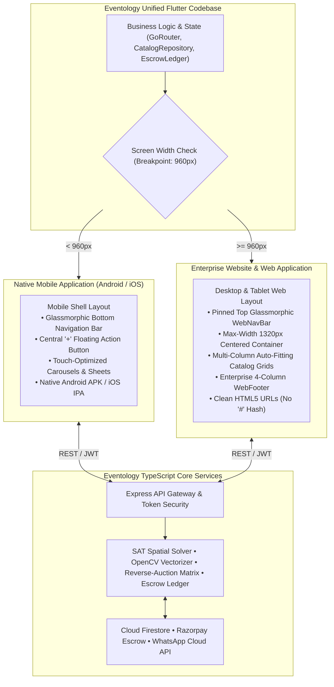

# Eventology (Flagship Enterprise Platform)

<p align="center">
  
</p>

<p align="center">
  <strong>The Deterministic Event Production & Engineering Platform</strong><br>
  Mathematical Spatial Solvers • NBC 2016 Life Safety Proofs • 25/50/25 Milestone Escrow • Zero AI Theater
</p>

<p align="center">
  
  
  
  
  
  
  
  
</p>

---

## 🏛️ Executive Summary

**Eventology** is a high-reliability commercial event management and engineering platform built for high-stakes corporate galas, stadium concerts, weddings, and municipal festivals.

Unlike conversational chatbot apps or speculative LLM wrappers, Eventology operates exclusively on **deterministic engineering primitives**:
* **SAT 2D Polygon Packing Solvers** that prevent equipment and guest density conflicts.
* **NBC 2016 Life Safety Proofs** certifying emergency exit throughput and egress travel limits.
* **Double-Entry Escrow Ledgers** enforcing India's institutional 25% / 50% / 25% milestone payouts.
* **OpenCV Metric Vectorizers** transforming architectural paper blueprints into editable Draw.io / CAD layers.
* **Field Radar & Curfew Sentinels** monitoring 10:00 PM municipal acoustic cutoffs and dock logistics.

---

## 📱🌐 Unified Multiplatform Topology: Mobile App + Web Platform

Eventology is engineered as a **single unified multi-platform codebase** that builds native mobile applications and an enterprise web platform simultaneously without duplicated maintenance:



---

## ⚡ Core Engineering Pillars

### 1. 📐 Metric Blueprint Vectorization & CAD Export
* **OpenCV Morphological Processing:** Uploads architectural blueprints (PNG/JPG) and automatically extracts bounding perimeters, doorways, load-bearing pillars, and exits.
* **Direct Draw.io / XML Integration:** Synthesizes standard XML diagrams that open directly in diagrams.net / Draw.io for millimeter-accurate rigging planning.

### 2. 🚒 NBC 2016 Life Safety & Egress Verification
* **Occupant Density Calculations:** Validates floor area ratios against National Building Code of India (NBC 2016 Part 4).
* **Travel Distance Proofs:** Verifies that no point in the ballroom or outdoor ground exceeds the 30-meter maximum exit travel distance threshold.
* **Exit Width Clearance:** Proves exit door unit capacities ($50\text{ persons}/\text{unit width}$) to prevent crush disasters.

### 3. ⚖️ Blind Reverse-Auction Procurement
* **60-Second Itemized Bidding:** Onboarded vendors submit line-item equipment pricing in integer Paise with automated GST calculations.
* **Multi-Factor Scoring Matrix:**
  $$\text{Score} = (0.40 \times \text{Price}) + (0.30 \times \text{Tech Spec Match}) + (0.20 \times \text{Rating}) + (0.10 \times \text{Proximity})$$
* **Strict Confidentiality:** Quotations are cryptographically isolated so competitors cannot inspect pending bids before closing.

### 4. 💳 Institutional 25% - 50% - 25% Milestone Escrow
* **Milestone 1 (25% Advance):** Released upon mutual contract signing to fund equipment mobilization.
* **Milestone 2 (50% Dock Signoff):** Released upon QR-code loading dock arrival and successful soundcheck.
* **Milestone 3 (25% Final Settlement):** Released upon event strike completion and client signoff (or auto-settled after 48 hours absent dispute).

### 5. 🛡️ 5-Tier Institutional Vendor Onboarding
* **Tier 1 (Legal & KYC):** MCA legal entity name, 15-char GSTIN, 10-char PAN, signatory ID proof, emergency dispatch telephone.
* **Tier 2 (Bank Settlement):** Legal account holder name, bank name, account number, 11-char IFSC, cancelled cheque image.
* **Tier 3 (Equipment Manifest):** Category specifications (line array wattage, trussing alloy ratings, silent DG kVA, FSSAI licenses).
* **Tier 4 (Site Operations):** Connected 3-phase load in kVA, crew headcount, transport fleet vehicles, load-in and strike durations.
* **Tier 5 (Commercial Policies):** Base day rate in integer Paise, standard/moderate/strict cancellation policies, commercial general liability insurance.

---

## 📂 Repository Structure

```
Eventology/
├── README.md                          # Platform documentation
├── firebase.json                      # Firebase Hosting (SPA) & Firestore emulator rules
├── vercel.json                        # Vercel Edge CDN configuration
│
├── eventology_app/                    # Unified Flutter Multiplatform Application
│   ├── android/                       # Native Android container & Gradle build
│   ├── ios/                           # Native iOS container & Xcode project
│   ├── web/                           # Web application assets (index.html, manifest.json)
│   ├── lib/
│   │   ├── main.dart                  # App bootstrap with HTML5 usePathUrlStrategy
│   │   ├── core/
│   │   │   ├── routing/app_router.dart # Public discovery & role-based route guards
│   │   │   ├── theme/app_colors.dart  # Obsidian dark mode (#070709) & Gold (#FFD700)
│   │   │   └── widgets/               # WebNavBar, WebFooter, ResponsiveWebContainer
│   │   ├── features/
│   │   │   ├── admin/                 # Executive governance, KYC, and escrow releases
│   │   │   ├── user/                  # Storefront, Discovery, and Production Studio
│   │   │   └── vendor/                # Vendor portal, RFQs, Calendar, Settlements
│   │   └── services/                  # Firestore, Auth, Escrow, and RFQ APIs
│   └── firestore.rules                # Production security rules
│
├── eventology_backend/                # TypeScript / Node.js Engine
│   └── src/
│       ├── api/                       # Express routes (Admin, Escrow, RFQ, Operations)
│       ├── services/                  # Spatial solver, CAD vectorizer, and ledger
│       └── tests/                     # Jest test suites
│
└── packages/                          # Standalone open-source packages
    ├── drawio-floorplan/              # Metric Draw.io / XML floorplan generator
    ├── spatial-egress/                # NBC 2016 life-safety egress engine
    └── stage-cue-engine/              # Real-time ROS cue sheet executor
```

---

## 🚀 Quick Start & Build Guide

### Prerequisites
* **Flutter SDK:** `^3.24.0`
* **Node.js:** `>=20.0.0` (Recommended `v22.x`)
* **Python:** `>=3.10` (with `opencv-python` and `numpy` for blueprint vectorization)

### 1. Backend Setup & Run
```bash
cd eventology_backend
npm install
npm run build
npm run dev
```

### 2. Frontend Local Development
```bash
cd eventology_app
flutter pub get

# Run on Desktop Web (Chrome)
flutter run -d chrome

# Run on Mobile (Android Emulator / Device)
flutter run -d android
```

### 3. Production Multiplatform Builds
```bash
cd eventology_app

# Build Web Bundle (for Firebase Hosting / Vercel / Cloudflare)
flutter build web --release

# Build Android Production APK / App Bundle
flutter build apk --release
flutter build appbundle --release

# Deploy to Firebase Hosting
firebase deploy --only hosting
```

---

## 🧪 Automated Verification & Quality Gates

* **Flutter Frontend:** `flutter test` &rarr; Verified unit, widget, and role routing tests.
* **Backend Engine:** `npm test` &rarr; 51 core test suites passing (595 tests).
* **Static Analysis:**
  * `dart analyze` &rarr; Clean (0 errors).
  * `npx tsc --noEmit` &rarr; Clean (0 compilation errors).

---

## 🔐 Production Secrets & Environment Variables

| Key | Provider | Scope |
| :--- | :--- | :--- |
| `RAZORPAY_KEY_ID` | Razorpay Dashboard | Live API Key ID |
| `RAZORPAY_KEY_SECRET` | Razorpay Dashboard | Live API Secret |
| `RAZORPAY_WEBHOOK_SECRET` | Razorpay Dashboard | Webhook verification secret |
| `FIREBASE_PROJECT_ID` | Google Cloud | Production project ID |
| `FIREBASE_SERVICE_ACCOUNT` | GCP IAM | Service account JSON string |
| `WHATSAPP_ACCESS_TOKEN` | Meta Developer Portal | System User Permanent Token |
| `WHATSAPP_PHONE_NUMBER_ID`| Meta Developer Portal | Indian Business Phone ID |
| `CORS_ORIGIN` | DNS / Hosting | Whitelist production domain |

---

<p align="center">
  <sub>Built with engineering precision for the event production industry.</sub>
</p>
