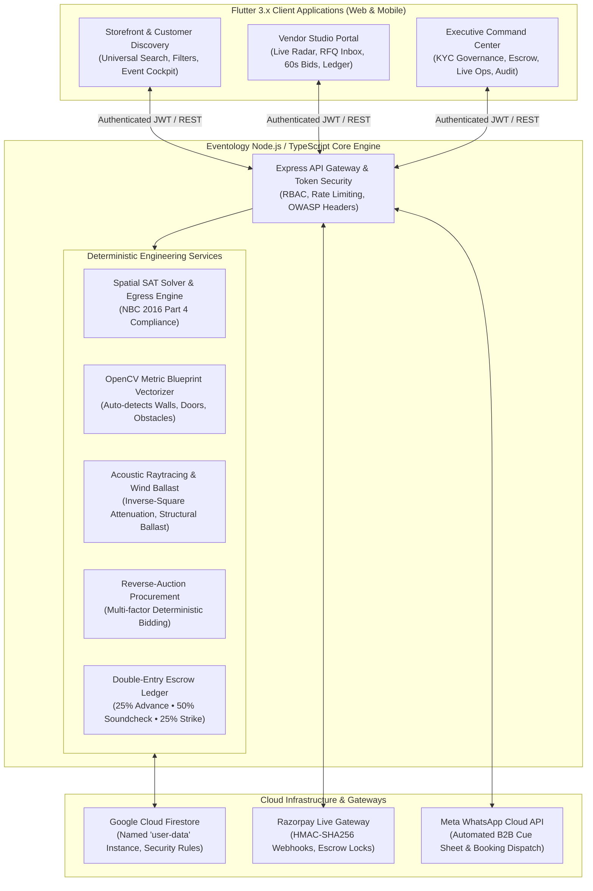

# Eventology (Flagship Enterprise Platform)

<p align="center">
  
</p>

<p align="center">
  <strong>The Deterministic Event Production & Engineering Platform</strong><br>
  Mathematical Spatial Solvers • NBC 2016 Life Safety Proofs • 25/50/25 Milestone Escrow • Zero AI Theater
</p>

<p align="center">
  
  
  
  
  
  
  
</p>

---

## 🏛️ Executive Summary

**Eventology** is a high-reliability commercial event management and engineering platform built for high-stakes corporate galas, stadium concerts, weddings, and municipal festivals.

Unlike conversational chatbot apps or speculative LLM wrappers, Eventology operates exclusively on **deterministic engineering primitives**:
* **SAT 2D Polygon Packing Solvers** that prevent equipment and guest density conflicts.
* **NBC 2016 Life Safety Proofs** certifying emergency exit throughput and egress travel limits.
* **Double-Entry Escrow Ledgers** enforcing India's institutional 25% / 50% / 25% milestone payouts.
* **OpenCV Metric Vectorizers** transforming architectural paper blueprints into editable Draw.io / CAD layers.
* **Field Radar & Curfew Sentinels** monitoring 10:00 PM municipal acoustic cutoffs and dock logistics.

---

## 🏗️ Architecture & System Topology



---

## ⚡ Core Engineering Pillars

### 1. 📐 Metric Blueprint Vectorization & CAD Export
* **OpenCV Morphological Processing:** Uploads architectural blueprints (PNG/JPG) and automatically extracts bounding perimeters, doorways, load-bearing pillars, and exits.
* **Direct Draw.io / XML Integration:** Synthesizes standard XML diagrams that open directly in diagrams.net / Draw.io for millimeter-accurate rigging planning.

### 2. 🚒 NBC 2016 Life Safety & Egress Verification
* **Occupant Density Calculations:** Validates floor area ratios against National Building Code of India (NBC 2016 Part 4).
* **Travel Distance Proofs:** Verifies that no point in the ballroom or outdoor ground exceeds the 30-meter maximum exit travel distance threshold.
* **Exit Width Clearance:** Proves exit door unit capacities ($50\text{ persons}/\text{unit width}$) to prevent crush disasters.

### 3. ⚖️ Blind Reverse-Auction Procurement
* **60-Second Itemized Bidding:** Onboarded vendors submit line-item equipment pricing in integer Paise with automated GST calculations.
* **Multi-Factor Scoring Matrix:**
  $$\text{Score} = (0.40 \times \text{Price}) + (0.30 \times \text{Tech Spec Match}) + (0.20 \times \text{Rating}) + (0.10 \times \text{Proximity})$$
* **Strict Confidentiality:** Quotations are cryptographically isolated so competitors cannot inspect pending bids before closing.

### 4. 💳 Institutional 25% - 50% - 25% Milestone Escrow
* **Milestone 1 (25% Advance):** Released upon mutual contract signing to fund equipment mobilization.
* **Milestone 2 (50% Dock Signoff):** Released upon QR-code loading dock arrival and successful soundcheck.
* **Milestone 3 (25% Final Settlement):** Released upon event strike completion and client signoff (or auto-settled after 48 hours absent dispute).

### 5. 🛡️ 5-Tier Institutional Vendor Onboarding
* **Tier 1 (Legal & KYC):** MCA legal entity name, 15-char GSTIN, 10-char PAN, signatory ID proof, emergency dispatch telephone.
* **Tier 2 (Bank Settlement):** Legal account holder name, bank name, account number, 11-char IFSC, cancelled cheque image.
* **Tier 3 (Equipment Manifest):** Category specifications (line array wattage, trussing alloy ratings, silent DG kVA, FSSAI licenses).
* **Tier 4 (Site Operations):** Connected 3-phase load in kVA, crew headcount, transport fleet vehicles, load-in and strike durations.
* **Tier 5 (Commercial Terms):** Base day rate floor, insurance policy numbers, and milestone escrow acceptance.

---

## 📁 Repository Structure

```text
Eventology/
├── eventology_app/              # Flutter 3.x Frontend (Web, Android, iOS)
│   ├── lib/
│   │   ├── core/                # Theme, routing, collections, firebase config
│   │   ├── features/
│   │   │   ├── admin/           # 4 Executive Consoles (KYC, Finance, Live Ops, Security)
│   │   │   ├── auth/            # Phone OTP, email authentication, role routing
│   │   │   ├── user/            # Discovery Storefront, 6-tab Production Cockpit
│   │   │   └── vendor/          # 5-Pillar Studio Portal, Radar, RFQ Inbox, Ledger
│   │   ├── models/              # Immutable data models (Vendor, Booking, Floorplan, etc.)
│   │   └── services/            # Firestore repositories, settlement & payment clients
│   └── test/                    # 148 automated Flutter unit, widget & integration tests
│
├── eventology_backend/          # Node.js 22 & TypeScript Core Production Engine
│   ├── src/
│   │   ├── api/                 # Express REST endpoints (Admin, RFQ, Payments, Settlements)
│   │   ├── config/              # Firebase Admin SDK & named database initializers
│   │   ├── middleware/          # Firebase JWT verification & RBAC guards
│   │   ├── services/
│   │   │   ├── ops/             # Stage cue engine & timecode run-of-show
│   │   │   ├── physics/         # Acoustic attenuation & wind load ballast calculators
│   │   │   ├── spatial/         # SAT 2D geometric packing & NBC 2016 egress solver
│   │   │   └── visual/          # OpenCV blueprint analysis service
│   │   └── tests/               # 53 Jest unit, performance & security test suites
│   ├── Dockerfile               # Production multi-stage Alpine container
│   └── package.json
│
├── packages/                    # Standalone Open-Source Computational Libraries
│   ├── drawio-floorplan/        # Metric CAD to Draw.io XML serializer
│   ├── spatial-egress/          # Deterministic NBC 2016 safety & egress engine
│   └── stage-cue-engine/        # SMPTE timecode run-of-show sequencer
│
└── firestore.rules              # Zero-trust production security rules
```

---

## 🚀 Quick Start Guide

### Prerequisites
* **Flutter SDK:** `^3.24.0`
* **Node.js:** `>=20.0.0` (Recommended `v22.x`)
* **Python:** `>=3.10` (with `opencv-python` and `numpy` for blueprint vectorization)

### 1. Backend Setup
```bash
cd eventology_backend
npm install
npm run build
npm test
```

### 2. Frontend Setup
```bash
cd eventology_app
flutter pub get
flutter analyze
flutter test
```

### 3. Running Locally
```bash
# Terminal 1: Backend API
cd eventology_backend
npm run dev

# Terminal 2: Flutter Web App
cd eventology_app
flutter run -d chrome
```

---

## 🧪 Automated Verification & Quality Gates

Every commit is validated against comprehensive test suites:

* **Flutter Frontend:** `flutter test` &rarr; **148 / 148 passing (100%)**
  * Vendor availability and session isolation
  * Reverse-auction quotation workflows
  * Settlements ledger and deduction calculations
  * Role-based routing guards (`user`, `vendor`, `admin`)
* **Backend Engine:** `npm test` &rarr; **53 / 53 passing (100%)**
  * Mathematical SAT geometric collision detection
  * NBC 2016 egress travel distance proofs
  * Double-entry escrow ledger balance conservation
  * Razorpay HMAC-SHA256 signature verification
* **Static Analysis:**
  * `dart analyze` &rarr; **0 errors, 0 warnings**
  * `npx tsc --noEmit` &rarr; **0 compilation errors**

---

## 🔐 Production Secrets & Deployment

When deploying to live production, configure the following environment variables:

| Key | Provider | Scope |
| :--- | :--- | :--- |
| `RAZORPAY_KEY_ID` | Razorpay Dashboard | Live API Key ID |
| `RAZORPAY_KEY_SECRET` | Razorpay Dashboard | Live API Secret |
| `RAZORPAY_WEBHOOK_SECRET` | Razorpay Dashboard | Webhook verification secret |
| `FIREBASE_PROJECT_ID` | Google Cloud | Production project ID |
| `FIREBASE_SERVICE_ACCOUNT` | GCP IAM | Service account JSON string |
| `WHATSAPP_ACCESS_TOKEN` | Meta Developer Portal | System User Permanent Token |
| `WHATSAPP_PHONE_NUMBER_ID`| Meta Developer Portal | Indian Business Phone ID |
| `CORS_ORIGIN` | DNS / Hosting | Whitelist production domain |

---

<p align="center">
  <sub>Built with engineering precision for the event production industry.</sub>
</p>
