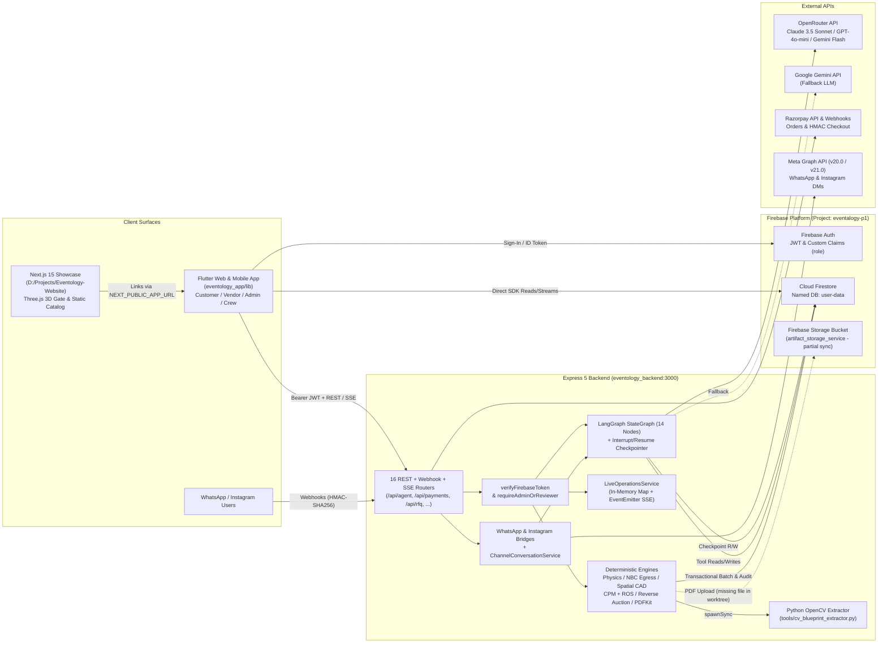
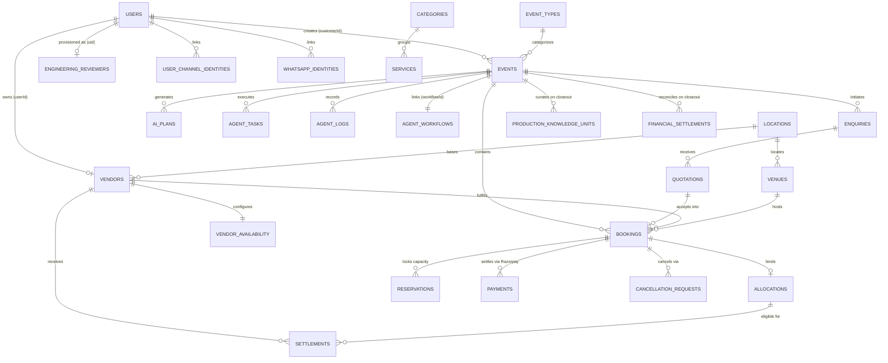

# Eventology (Eventalogy International) — Master Technical Blueprint

> **Audit Scope & Baseline:** Generated from static inspection of the main Eventology monorepo worktree (`eventology_system_documentation` branch, matching `main` commit baseline `8df8005` in `D:\Projects\Eventology`) and the companion marketing showcase repository (`D:\Projects\Eventology-Website`, latest commit `5500433` deployed at `https://eventology-website.vercel.app`). All symbols, routes, collections, schemas, and gaps documented below reflect the actual codebase state without assumption.

---

## 1. Product & High-Level Architecture

### 1.1 Core Purpose
**Eventology** (branded externally as **Eventalogy International**) is a multi-tenant event production, engineering-verification, procurement, and escrow marketplace platform built for luxury weddings, corporate summits, exhibitions, and live concerts. It combines:
1. A **14-node LangGraph multi-agent orchestration engine** (`eventology_backend/src/graph/index.ts`) for conversational event intake, service/venue/vendor matching, availability checks, and budget estimation.
2. **Deterministic physical engineering & spatial CAD engines** (`eventology_backend/src/services/physics/`, `services/spatial/`) implementing NBC 2016 Part 4 life-safety egress screening, AC electrical load checks, beam rigging reactions, IS 875 Part 3 wind-load ballast sizing, acoustic SPL ray-tracing, and OpenCV blueprint vectorization (`tools/cv_blueprint_extractor.py`).
3. A **transactional procurement & escrow ledger** (RFQs, quotations, bookings, capacity reservations, milestone settlements, cancellations, Razorpay payment orders/webhooks).
4. A **day-of-show Live Operations coordinator** (`LiveOperationsService` + Server-Sent Events stream) and post-event telemetry curation (`ProductionKnowledgeUnit` / PKU closeout).
5. **Dual web/mobile client surfaces**: a Flutter Web/Android/iOS operational application (`eventology_app/`) and a standalone Next.js 15 3D storytelling marketing gateway (`D:\Projects\Eventology-Website`).

### 1.2 Target Users & Roles
Verified across `eventology_app/firestore.rules`, `eventology_backend/src/api/admin_routes.ts`, and `eventology_app/lib/core/routing/app_router.dart`:
- **Customer (`role: 'user'`):** Plans events, browses venues/vendors, sends enquiries, accepts quotations or RFQ trade packages, pays Razorpay bookings, monitors Event Production Studio specs, links WhatsApp/Instagram channels, and requests cancellations.
- **Vendor / Supplier (`role: 'vendor'`):** Completes 5-tier KYC onboarding (`BecomeVendorScreen`), manages daily operating hours / blackout dates (`vendor_availability`), responds to manual enquiries with quotations, submits bids in reverse-auction RFQs, executes fulfillment milestones with completion evidence, and tracks settlement ledgers.
- **Administrator (`role: 'admin'`):** Verifies vendors/venues, cancels events, oversees the cancellation/refund queue, proposes/approves/reconciles/disburses vendor settlements, reviews audit logs, provisions engineering reviewers, and triggers SFT/DPO dataset exports.
- **Engineering Reviewer (`engineering_reviewers` registry / PE reviewer):** Provisioned via `EngineeringReviewerService`; signs off, rejects, or places holds on `technical_reviews` (structural rigging, electrical distribution, acoustic curfew, life-safety egress) before customer booking approval can complete. `admin_routes.ts` (`requireAdminOrReviewer`) authorizes Firebase custom claims `role === "admin"`, `isEngineeringReviewer === true`, `engineeringRoles[]`, or `role` in `["fire_safety_engineer", "structural_engineer", "electrical_engineer"]`.
- **Live Crew Station Operators (`CrewStationId`):** `foh_audio`, `lighting_ld`, `video_director`, `stage_manager`, `rigging_lead`, `catering_lead`, `security_lead` interacting with real-time cue execution and safety holds via `/operations/session/:eventId/station/:stationId`.

### 1.3 Implemented vs. Stubbed / Incomplete Capabilities

| Domain | Actually Implemented | Stubbed / Incomplete / Disconnected |
|---|---|---|
| **Marketing Website (`Eventology-Website`)** | 3D GSAP/Three.js square-door portal showcase (`StorytellingScrollInner.tsx`), interactive NBC scale & escrow sliders, static venue/vendor catalogs, Vercel deployment. | **Lead/Contact forms** (`CallbackModal.tsx`, `src/app/contact/page.tsx`) only toggle React `submitted` state with zero backend/CRM API call; `/venues` and `/vendors` render hardcoded arrays (`venuesCatalog`, `vendorsCatalog`) rather than Firestore. |
| **Flutter Client (`eventology_app`)** | Auth & role-based GoRouter (`/` -> `/home`, `/vendor`, `/admin`), Firestore real-time streams (`user-data` DB), **5-step guided AI planner (`/planner`), live 14-agent SSE split workspace (`/ai-chat`), persistent floating AI chat dock (`FloatingAiConcierge`)**, Razorpay booking checkout UI, Procurement RFQ UI, Live Operations SSE dashboard, WhatsApp linking screen, 5-tier vendor onboarding, Admin Operations Console. | `EventDetailScreen` **Floorplan CAD tab** (`event_detail_screen.dart:379`) renders a hardcoded `const mockLayout` (`TechnicalFloorplanModel`) and snackbar stubs on DXF / Draw.io buttons; `LiveOperationsClientService` falls back to in-memory `_mockSessions` if backend is unreachable. |
| **LangGraph Agents & AI** | 14-node graph compiled with `FirestoreCheckpointer` (or `MemorySaver`), parallel `Send[]` specialist fan-out, real `interrupt()` gates (`approval_agent`, `technical_review_agent`), OpenRouter + Gemini fallback provider, deterministic physics & logistics nodes. | `generateConceptVisualTool` (`tools/visual_generation.ts`) is **not bound to any agent** in `agents/*.ts`; OpenRouter/Imagen generation falls back to `offline_placeholder` without API keys; `eventology_app/backend/` is a leftover standalone legacy 1-route Express server. |
| **Payments, Settlements & Refunds** | Razorpay order creation, HMAC signature verification (`verify`), webhook handler (`payment.captured`, `payment.failed`), sandbox simulate routes, idempotent state transitions, double-entry settlement ledger (`propose -> approve -> reconcile`). | **Live bank payouts & live refunds are disabled (`payout_not_configured`):** `SettlementService.executeDisbursement` blocks live transfers until nodal banking / RazorpayX is integrated; `CancellationService.executeRefund` supports simulated mode in test/dev and preserves `payout_not_configured` in live mode. |
| **Omnichannel Bots** | Meta WhatsApp webhook (`POST /api/whatsapp/webhook`) & Instagram DM webhook (`POST /api/instagram/webhook`) with HMAC-SHA256 verification and LangGraph routing via bridges. | WhatsApp rate limiter (`rateLimitMap`), Instagram dedup cache (`Set` max 5000), `LiveOperationsService.sessions`, and `ChannelConversationService` caches are **process-local in-memory**; `omnichannel_routes.ts` (`POST /link-account`, `POST /message`) lacks authentication middleware. |
| **Artifact Storage & Monorepo Sync** | Deterministic PDF generation (`pdfkit` with SHA-256 hash), SVG/DXF/Draw.io XML serializers. | `eventology_backend/src/services/storage/artifact_storage_service.ts` is **missing from this worktree** (exists untracked in `D:\Projects\Eventology`), even though `artifact_routes.ts` imports it; `packages/*` (`@eventology/drawio-floorplan`, `@eventology/spatial-egress`, `@eventology/stage-cue-engine`) are standalone TypeScript packages not imported via `package.json` dependencies in `eventology_backend`. |

### 1.4 Full Technology Stack

| Layer | Technologies & Exact Versions (from `package.json` / `pubspec.yaml`) |
|---|---|
| **Marketing Web Showcase** | Next.js `^15.1.6`, React `^19.0.0`, TypeScript `^5.7.3`, Tailwind CSS `^3.4.17`, Three.js `^0.187.0`, GSAP `^3.15.1`, `lucide-react ^0.475.0`, hosted on **Vercel** (`https://eventology-website.vercel.app`). |
| **Operational App (Web & Mobile)** | Flutter / Dart SDK `^3.13.3` (`eventology_app`), `go_router ^18.0.1`, `firebase_core ^4.15.0`, `firebase_auth ^6.7.0`, `cloud_firestore ^6.10.0`, `google_fonts ^8.2.1`, `http ^1.6.0`, `intl ^0.20.3`. Configured for Firebase Hosting (`eventology_app/build/web`) and Vercel static SPA fallback (`vercel.json`). |
| **Backend API Runtime** | Node.js + TypeScript `^5.0.0`, Express `^5.2.1` (HTTP timeout set to 600,000 ms), `cors ^2.8.6`, `dotenv ^18.0.4`, `zod ^4.6.5`, `axios ^1.20.0`, `uuid ^14.0.2`. |
| **AI / Agent Orchestration & LLMs** | `@langchain/langgraph ^1.4.18`, `@langchain/langgraph-checkpoint ^1.1.5`, `@langchain/core ^1.2.13`, `@langchain/openai ^1.6.0` (targeting **OpenRouter** `https://openrouter.ai/api/v1`), `@langchain/google-genai ^2.3.2` (**Google Gemini** fallback). Image generation gateway supports OpenRouter Flux/SDXL & Vertex AI Imagen 3 (`imagen-3.0-fast-generate-001`). |
| **Database & Persistence** | **Google Cloud Firestore** named database **`user-data`** (`firebase-admin ^14.5.0` on backend; `FirebaseFirestore.instanceFor(databaseId: 'user-data')` on Flutter). Firebase project ID: `eventalogy-p1`. |
| **Authentication** | **Firebase Authentication** (Email/Password on Flutter, Firebase ID Tokens verified via Admin SDK `verifyIdToken` in `verifyFirebaseToken`, Custom Token Claims `role: 'admin' | 'vendor' | 'user'`). |
| **Payments** | **Razorpay** Node SDK `^2.9.8` (Checkout Orders, HMAC-SHA256 payment verification, Webhook verification). |
| **Document / CAD / CV Processing** | `pdfkit ^0.20.2` (A4 technical briefs, BOMs, Run-of-Show PDFs), deterministic TypeScript spatial serializers (Draw.io `mxGraphModel` XML, SVG, AutoCAD DXF), Python OpenCV script (`tools/cv_blueprint_extractor.py` using `cv2` & `numpy` via `spawnSync`). |
| **Queues, Caching & Realtime** | **No Redis, BullMQ, Kafka, or Vector DB.** Realtime Live Operations uses Node `EventEmitter` + HTTP Server-Sent Events (SSE). LangGraph state checkpoints persist to Firestore `_agent_checkpoints`. Rate limits, Instagram dedup, and PKU cache use process-local `Map`/`Set`. |
| **Testing & Local Dev** | Jest `^30.5.2` + `ts-jest ^29.4.14`, Firebase Local Emulator Suite (`auth: 9099`, `firestore: 8080`). |

### 1.5 Folder Structure & Entry Points

**Main Monorepo (`eventology_system_documentation` / `D:\Projects\Eventology`):**
- `eventology_backend/` — Core Express API, LangGraph agents, deterministic physics/spatial/logistics engines, Razorpay, omnichannel webhooks, verification scripts, and Jest suites.
  - **Entry point:** `eventology_backend/src/index.ts` (Express server bootstrap, CORS, OWASP headers, `/api/*` router mounts, `/health`, `/api/seed`).
  - `src/graph/` — LangGraph `StateGraph` (`index.ts`), `GraphState` reducers (`state.ts`), legacy `routing.ts`.
  - `src/agents/` — 14 active graph node modules (`*_agent.ts`) + legacy `event_intake/agent.ts` & `event_planning/agent.ts`.
  - `src/api/` — 16 modular Express routers.
  - `src/tools/` — LangChain `tool(...)` wrappers (`venues.ts`, `vendors.ts`, `services.ts`, `availability.ts`, `bookings.ts`, `firestore.ts`, `visual_generation.ts`) + `cv_blueprint_extractor.py`.
  - `src/services/` — Business, escrow, physics (`physics/`), spatial (`spatial/`), logistics (`logistics/`), ops (`ops/`), PDF (`pdf/`), procurement (`procurement/`), visual (`visual/`), training/PKU (`training/`), omnichannel bridges, and `FirestoreCheckpointer`.
  - `src/scripts/` — CLI seed (`seedProduction.ts`), role claim tool (`setRole.ts`), E2E demo (`run_e2e_corporate_conference_demo.ts`), 16+ collection verifier scripts (`verify*.ts`).
  - `src/tests/` — ~60 Jest unit/integration/emulator tests & live probe scripts.
- `eventology_app/` — Flutter Web & mobile client + Firebase rules/indexes + legacy backend folder.
  - **Entry point:** `eventology_app/lib/main.dart` -> `EventologyApp` (`MaterialApp.router` using `app_router.dart`).
  - `lib/core/` — `ApiConfig`, `Collections`, `FirebaseOptions`, `EmulatorConfig`, `FirestoreConfig` (`user-data`), `app_router.dart`, `app_colors.dart`, `app_theme.dart`, shared web layout widgets.
  - `lib/models/` — 28+ Dart data models (`fromFirestore` / JSON models).
  - `lib/services/` — `AuthStateNotifier`, `FirebaseAuthService`, 21 Firestore repositories (`lib/services/firestore/`), 8 REST API client services (`*_api_service.dart`).
  - `lib/features/` — Role-segmented UI modules (`auth/`, `user/`, `vendor/`, `admin/`).
  - `firestore.rules` & `firestore.indexes.json` — Security rules & composite indexes for `user-data`.
  - `backend/` — Legacy minimal Express server (`server.ts`, single `POST /api/ai/generate-event-plan` route).
- `packages/` — Three standalone TypeScript packages (`@eventology/drawio-floorplan`, `@eventology/spatial-egress`, `@eventology/stage-cue-engine`), each with `package.json`, `tsconfig.json`, and `src/index.ts`.
- `architecture_specifications/` — Markdown design specs & architecture docs.
- Root config: `.firebaserc` (`eventalogy-p1`), `firebase.json` (hosting `eventology_app/build/web`, emulator ports), `vercel.json` (SPA rewrite `/(.*) -> /index.html` + OWASP headers), `EVENTOLOGY_MASTER_SYSTEM_DOCUMENTATION.md`, `PROJECT_EXECUTION_MAP.md`.

**Companion Showcase Repo (`D:\Projects\Eventology-Website`):**
- **Entry points:** `src/app/layout.tsx`, `src/app/page.tsx` (`StorytellingScrollInner.tsx` 3D gate + light luxury sections).
- Routes: `/`, `/app`, `/venues`, `/vendors`, `/escrow`, `/technology`, `/contact`, `/privacy`, `/terms`.
- `src/components/` — `Navbar`, `Footer`, `CallbackModal`, `ScaleEstimator`, `Interactive3DStage`, `ThreeBackground`, `TiltCard`, and `scroll/*` (`GrandGatePortal.ts`, `InvitationCard3D.ts`, `CelebrationScene.tsx`, `GatewayDock.tsx`, `ScrollScrubEngine.ts`).

### 1.6 High-Level Architecture Diagram

---

## 2. Database & Data Layer

### 2.1 Engine, Access Layer & Setup
- **Primary Database Engine:** **Google Cloud Firestore** in Native mode, explicitly targeting a **named database** `"user-data"` (not `(default)`).
  - Backend binding (`eventology_backend/src/config/firebase.ts:68`): `getFirestore(app, "user-data")` with `ignoreUndefinedProperties: true`. Fails closed in `production` if `FIRESTORE_EMULATOR_HOST` or `FIREBASE_AUTH_EMULATOR_HOST` is set.
  - Flutter binding (`eventology_app/lib/core/firebase/firestore_config.dart:7`): `FirebaseFirestore.instanceFor(app: Firebase.app(), databaseId: 'user-data')`.
- **ORM / Query Builder:** No SQL ORM or Prisma/Drizzle. Access uses native `firebase-admin/firestore` SDK on backend and typed `cloud_firestore` repository singletons (`eventology_app/lib/services/firestore/*_repository.dart`) wrapping `CollectionReference` / `fromFirestore` Dart models (`eventology_app/lib/models/*.dart`).
- **Schema Governance, Security Rules & Migrations:**
  - **No schema migration runner** (schema-less document evolution handled in application serializers and seed/verify scripts in `eventology_backend/src/scripts/`).
  - **Firestore Security Rules** (`eventology_app/firestore.rules`): Enforces RBAC using `request.auth.token.role` (`admin`, `vendor`, `user`), locks `users/{userId}` against self-escalation (`notModifying(['role', 'uid'])`), makes `audit_logs` write-once/immutable, and restricts `payments`, `settlements`, `quotations`, `agent_workflows`, `agent_checkpoints`, `_agent_checkpoints`, `agent_checkpoint_writes`, `whatsapp_*`, `instagram_*` to **Admin SDK only** (`allow write: if false`).
  - **Composite Indexes** (`eventology_app/firestore.indexes.json`): 10 composite indexes across `enquiries` (`vendorId+createdAt`), `rfqs` (`workflowId+createdAt`, `matchedVendorIds[CONTAINS]+dispatchedAt`), `quotations` (`enquiryId+createdAt`, `vendorId+createdAt`), `bookings` (`customerId+createdAt`, `vendorId+createdAt`, `eventId+createdAt`), and `settlements` (`vendorId+createdAt`, `status+createdAt`).

### 2.2 Complete Collection Inventory & Key Fields

Grouped by functional domain (combining `eventology_app/lib/core/database/collections.dart`, `firestore.rules`, `eventology_app/lib/models/*.dart`, and backend `.collection(...)` calls):

#### A. Identity, Catalog & Event Core
1. **`users`** (`UserModel`): `uid` (PK), `name`, `email`, `role` (`user|vendor|admin`), `phone?`, `photoUrl?`, `createdAt`, `updatedAt`.
2. **`engineering_reviewers`** (`EngineeringReviewerProfile`): `uid` (PK), `email`, `displayName?`, `authorizedDisciplines` (`TechnicalReviewCategory[]`), `authorizedRoles` (`TechnicalReviewerRole[]`), `status` (`active|revoked|suspended`), `professionalCredentialStatus`, `isProfessionallyVerified`, `isEmailVerified`, `licenseOrRegistrationNumber?`, `provisionedByUid`, `provisionedAt`, `revokedByUid?`, `revocationReason?`.
3. **`locations`** (`LocationModel`): `locationId`, `country`, `state`, `city`, `area`, `pincode`, `latitude`, `longitude`.
4. **`categories`** (`CategoryModel`): `categoryId`, `name`, `description?`, `type`, `active`, `createdAt`.
5. **`eventTypes`** (`EventTypeModel`): `eventTypeId`, `name`, `description?`, `defaultGuestRange`, `suggestedServiceIds`, `active`, `createdAt`.
6. **`venueTypes`** (`VenueTypeModel`): `venueTypeId`, `name`, `description?`, `active`.
7. **`venues`** (`VenueModel` + `VenueTechnicalService` specs): `venueId`, `name`, `description?`, `venueTypeId`, `locationId`, `capacity`, `priceFrom?`, `priceTo?`, `amenities[]`, `images[]`, `contactName?`, `contactPhone?`, `status`, `verified`, plus technical rider fields (`spatial`, `electrical`, `rigging`, `logistics`), `createdAt`, `updatedAt`.
8. **`vendors`** (`VendorModel`): `vendorId`, `userId` (FK `users.uid`), `businessName`, `ownerName`, `description?`, `categoryIds[]`, `serviceIds[]?`, `locationId?`, `phone?`, `email?`, `pricingModel?`, `portfolioImages[]?`, `rating?`, `verified`, `status`, `payoutStatus`, `gstNumber?`, `legalEntityName?`, `tradeName?`, `entityType?`, `panNumber?`, `registeredAddress?`, `signatoryName?`, `bankAccountHolder?`, `bankName?`, `accountNumber?`, `ifscCode?`, `accountType?`, `equipmentManifest?`, `maxPowerDrawKva?`, `coreCrewHeadcount?`, `setupLeadTimeHours?`, `strikeTimeHours?`, `baseDayRatePaise?`, `escrowTermsAccepted`, `cancellationPolicy?`, `createdAt`, `updatedAt`.
9. **`services`** (`ServiceModel`): `serviceId`, `name`, `categoryId`, `subcategoryId?`, `description?`, `pricingModel`, `basePrice?`, `images[]`, `active`, `createdAt`, `updatedAt`.
10. **`packages`** (`PackageModel`): `packageId`, `name`, `description?`, `serviceIds[]`, `price`, `discount?`, `active`, `createdAt`, `updatedAt`.
11. **`events`** (`EventModel`): `eventId`, `customerId` (FK `users.uid`), `eventTypeId`, `title`, `eventDate`, `guestCount?`, `budget?`, `locationId?`, `venueId?`, `requirements?`, `status`, `paymentStatus?`, `conversationId?`, `workflowId?`, `createdAt`, `updatedAt`.
12. **`settings`** (`SettingModel`): `settingId`, `value` (Map), `updatedAt`.

#### B. Procurement, Bookings, Availability & Escrow Transactions
13. **`enquiries`** (`EnquiryModel`): `enquiryId`, `eventId`, `customerId`, `vendorId`, `serviceId`, `message`, `requirements?`, `requestedDate`, `status`, `createdAt`, `updatedAt`.
14. **`quotations`** (`QuotationModel`): `quotationId`, `enquiryId`, `eventId`, `customerId`, `vendorId`, `serviceId`, `currency`, `lineItems[]` (`description`, `quantity`, `unitPricePaise`, `totalPaise`), `subtotalPaise`, `taxPaise`, `totalAmountPaise`, `inclusions[]`, `exclusions[]`, `notes?`, `validUntil`, `status`, `bookingId?`, `allocationId?`, `submittedBy`, `createdAt`, `updatedAt`, `acceptedAt?`, `declinedAt?`, `declineReason?`.
15. **`vendor_rfqs` & `rfq_batches`** (vs. **`rfqs`** in `firestore.rules` / `firestore.indexes.json`): `VendorRfqService` (`vendor_rfq_service.ts:131-132`) writes RFQ packages to `vendor_rfqs` and batches to `rfq_batches` (with in-memory `offlinePackages` / `offlineBatches` fallbacks). Package fields: `packageId`, `workflowId`, `rfqBatchId`, `category`, `title`, `eventName`, `eventDate?`, `venueName?`, `guestCount?`, `lineItems[]`, `totalEstimatedCostPaise`, `currency` (`INR`), `deliveryDeadlineIso`, `status`, `matchedVendorIds[]?`, `vendorId?`, `quotedAmountPaise?`, `counterBidAmountPaise?`, `itemPrices[]?`, `paymentMilestoneId?`. Batch fields: `rfqBatchId`, `workflowId`, `eventName`, `totalPackages`, `dispatchedCount`, `quotedCount`, `acceptedCount`, `totalApprovedCostPaise`, `status`. *(Note: `vendor_rfqs` and `rfq_batches` do not match the `rfqs` rules/indexes in `firestore.rules`.)*
16. **`bookings`** (`BookingModel`): `bookingId`, `eventId`, `customerId`, `vendorId`, `serviceId`, `venueId?`, `packageId?`, `amount`, `amountInPaise?`, `currency`, `status`, `paymentStatus`, `quotationId?`, `enquiryId?`, `allocationId?`, `fulfillmentStatus`, `fulfillmentMilestones[]`, `completionEvidence?`, `completionReview?`, `cancellationStatus?`, `cancellationRequestId?`, `bookingDate`, `createdAt`, `updatedAt`.
17. **`allocations`** (`AllocationModel`): `allocationId`, `eventId`, `vendorId?`, `venueId?`, `serviceId?`, `assignedBy`, `status`, `startTime`, `endTime`, `createdAt`.
18. **`vendor_availability`** (`VendorAvailabilityModel`): `vendorId` (doc ID), `isConfigured`, `timezone`, `operatingDays[]`, `operatingHours` (`open`, `close`), `setupBufferMinutes`, `teardownBufferMinutes`, `capacityType`, `defaultCapacity`, `blackoutDates[]`, `dateOverrides[]`, `updatedAt`.
19. **`reservations`** (`VendorCommitmentModel`): `reservationId`, `bookingId`, `eventId`, `vendorId`/`resourceId`, `eventDate`, `startTime`, `endTime`, `quantity`, `status` (atomic capacity locks managed by `AvailabilityService`).
20. **`payments`** (`PaymentModel`): `paymentId`, `eventId`, `bookingId`, `customerId`, `amount`, `currency`, `paymentMethod`, `transactionId` (Razorpay order/payment IDs), `status`, `paidAt?`, `createdAt`.
21. **`settlements`** (`SettlementModel`): `settlementId`, `proposalReference`, `eventId`, `bookingId?`, `paymentId`, `vendorId`, `allocationId`, `currency`, `grossAmountPaise`, `deductionsPaise`, `netAmountPaise`, `status`, `calculationInputs` (`platformFeeBps`, `withholdingTaxBps`, etc.), `proposedBy`, `approvedBy?`, `rejectedBy?`, `disbursementStatus` (`payout_not_configured|queued|executed|failed`), `disbursementBlockedReason?`, `reconciliationEvidence?`, `reconciledBy?`, `reversedBy?`, `createdAt`, `updatedAt`.
22. **`financial_settlements`** (`FinancialReconciliationResult` in `PostEventCloseoutService`): `settlementId`, `eventId`, `escrowDepositHeld`, `totalCrewOvertimeCost`, `totalGeneratorOverageCost`, `totalDamageDeductions`, `netTotalDeductions`, `remainingEscrowToRefund`, `status` (`REFUND_DUE|SETTLED|DEFICIT_OWED`), `closedByUid`, `reconciledAtIso`.
23. **`cancellation_requests`** (`CancellationRequestModel`): `requestId`, `bookingId`, `eventId`, `customerId`, `vendorId`, `allocationId?`, `cancellationStatus`, `refundStatus`, `reason`, `customerNotes?`, `calculation` (`policyVersion`, `windowTier`, `grossPaidPaise`, `deductionBps`, `refundEstimatePaise`, `approvedRefundPaise?`), `hasSettlementConflict`, `reviewedBy?`, `reviewDecision?`, `refundExecution?` (`mode`, `providerRefundId`, `isSimulated`), `createdAt`, `updatedAt`.
24. **`reviews`** (`ReviewModel`): `reviewId`, `eventId`, `customerId`, `vendorId`, `venueId?`, `rating`, `comment`, `createdAt`.
25. **`disputes`**: Declared in `firestore.rules` (customer/vendor/admin scoped read/create).
26. **`notifications`** (`NotificationModel` / `DispatchedNotificationRecord`): `notificationId`, `userId`/`recipientId`, `workflowId?`, `type`/`eventType`, `title`, `message`/`body`, `eventId?`, `channels?`, `read`, `createdAt`.
27. **`audit_logs`** (`AuditLogModel`): `logId`, `actorId`, `actorRole`, `action`, `resourceType`, `resourceId`, `metadata?`, `timestamp` (append-only via rules).

#### C. AI Agents, Checkpoints, Telemetry & Omnichannel
28. **`ai_plans`** (`AiPlanModel` / `AIPlanData`): `planId`, `eventId?`, `userId`, `eventRequirements`, `recommendations[]`, `estimatedBudget`, `status`, `createdAt`, `updatedAt`.
29. **`ai_recommendations`** (`AiRecommendationModel`): `recommendationId`, `eventId`, `serviceId?`, `vendorId?`, `venueId?`, `reason`, `score`, `status`, `createdAt`.
30. **`agent_workflows`**: Written by `artifact_routes.ts` and protected in `firestore.rules` — stores serialized artifacts, signed-off workflow state, and PDF references per `workflowId`.
31. **`agent_tasks`** (`AgentTaskModel`): `taskId`, `eventId?`, `workflowId`, `agentType`, `status`, `input`, `output?`, `requiresApproval`, `approvedBy?`, `createdAt`, `completedAt?` (also used for technical review holds by `EngineeringHoldService`).
32. **`agent_logs`** (`AgentLogModel`): `logId`, `taskId?`, `workflowId`, `agentType`, `action`, `status`, `metadata`, `createdAt`.
33. **`_agent_checkpoints`** (with subcollections **`checkpoints`** & **`writes`**): Managed by `FirestoreCheckpointer` (`eventology_backend/src/services/firestore_checkpointer.ts`) storing LangGraph state snapshots (`checkpoint`, `metadata`, `parent_config`, `pending_writes`). (`firestore.rules` also matches `agent_checkpoints` & `agent_checkpoint_writes`.)
34. **`production_knowledge_units`** (`ProductionKnowledgeUnit`): `pkuId`, `eventId`, `venueId?`, `venueName`, `curatedAtIso`, `engineeringBenchmarks` (`actualPeakPowerKw`, `actualPeakLoadKg`, `actualAudioLeqDb`, `generatorFuelConsumedLiters`), `vendorScorecards[]`, `operationalLearnings[]`, `accessPolicy` (`GLOBAL_SHARED_TECHNICAL_KNOWLEDGE`).
35. **`whatsapp_identities`** (`WhatsAppIdentity`): `waId` (PK), `phoneNumber`, `userId?`, `status` (`unlinked|linked|blocked`), `conversationId?`, `linkingToken?`, `linkingTokenExpiresAt?`, `lastMessageAt`.
36. **`whatsapp_processed_messages`**: `messageId` (PK), `processedAt`, `expireAt` (24h TTL deduplication).
37. **`user_channel_identities`** (`UserChannelIdentity`) & **`channel_identities`** (Instagram bridge): `channel` (`whatsapp|instagram`), `externalId`, `userId`, `status`, `linkedAt`, `verifiedAt`, `metadata?`.
38. **`channel_link_tokens`** (`ChannelLinkToken`): `token` (PK `LNK-<CH>-...`), `userId`, `channel`, `expiresAt`, `used`, `createdAt`.
39. **`instagram_identities`** & **`instagram_processed_messages`**: Declared in `firestore.rules` for Admin SDK isolation.
40. **`system_probes`**: Diagnostic probe writes used by `api/seed` or verification utilities.

### 2.3 Entity Relationship Diagram (Mermaid ERD)

### 2.4 Vector Databases, Caches & File Storage
- **Vector Databases:** **None.** `KnowledgeRetrievalService` (`eventology_backend/src/services/training/knowledge_retrieval_service.ts`) performs exact `where("venueName", "==", venueIdentifier)` queries on `production_knowledge_units` backed by an in-memory `Map<string, ProductionKnowledgeUnit[]>`, not embeddings.
- **Redis / External Cache:** **None.** Ephemeral state lives in process-local Node memory:
  - `whatsapp_routes.ts`: `rateLimitMap` (`Map`, max 20 msg/min per `waId`).
  - `instagram_routes.ts`: `processedMessageIds` (`Set`, max 5,000 IDs).
  - `LiveOperationsService`: static `sessions` `Map<string, LiveOperationsSession>` + `EventEmitter`.
  - `ChannelConversationService`: in-memory conversation state fallback.
  - `UserChannelIdentityService` & `EngineeringReviewerService`: in-memory test-fallback `Map`s.
- **File Storage Buckets:**
  - Configured Firebase storage bucket: `eventalogy-p1.firebasestorage.app` (`firebase_options.dart` & `FIREBASE_STORAGE_BUCKET` env check in `D:\Projects\Eventology\eventology_backend\src\services\storage\artifact_storage_service.ts`).
  - `artifact_storage_service.ts` is intended to store generated PDF artifacts and return signed/download URLs (`storage/artifacts/...`), **but the file is missing from the `eventology_system_documentation` worktree** (`D:\Projects\Eventology` has it untracked), and `eventology_app/pubspec.yaml` does not include `firebase_storage`.

---

## 3. AI Agents & Automation Workflows

### 3.1 LLM Provider & Model Routing (`eventology_backend/src/llm/provider.ts`)
- **Primary Provider:** **OpenRouter** via `@langchain/openai` `ChatOpenAI` pointed at `https://openrouter.ai/api/v1` (`OPENROUTER_API_KEY`).
  - **Role-based model selection (`role` option):**
    - `planning` -> `OPENROUTER_PLANNING_MODEL` || `"anthropic/claude-3.5-sonnet"`
    - `fast` -> `OPENROUTER_FAST_MODEL` || `"google/gemini-2.0-flash-001"`
    - `engineering` -> `OPENROUTER_ENGINEERING_MODEL` || `OPENROUTER_MODEL` || `"openai/gpt-4o-mini"`
    - `budget` -> `OPENROUTER_BUDGET_MODEL` || `OPENROUTER_MODEL` || `"openai/gpt-4o-mini"`
    - `chat` / default -> `OPENROUTER_CHAT_MODEL` || `OPENROUTER_MODEL` || `"openai/gpt-4o-mini"`
- **Fallback Provider:** **Google Gemini** via `@langchain/google-genai` `ChatGoogleGenerativeAI` (`GEMINI_API_KEY`, model `GEMINI_MODEL || "gemini-1.5-flash"`).
- **Image Generation Service (`services/visual/image_generation_service.ts`):** Supports OpenRouter (`OPENROUTER_IMAGE_MODEL`) and Vertex AI Imagen (`imagen-3.0-fast-generate-001`), with `offline_placeholder` fallback. **Currently unwired** from all LangGraph agents.

### 3.2 LangGraph State (`eventology_backend/src/graph/state.ts`)
`GraphState` uses `@langchain/langgraph` `Annotation.Root` with reducer semantics enabling parallel fan-out merges:
- **Identifiers & Control:** `workflowId`, `conversationId`, `userId`, `eventId`, `stateVersion` (incremented on invalidation), `changeLog` (`StateChangeLogEntry[]`), `currentAgent`, `currentStage` (`WorkflowStage`), `workflowStatus` (`"active" | "pending_user" | "completed" | "error"`), `lastError`, `retryCount`, `metadata`.
- **Conversational Intake:** `userMessage`, `conversationHistory` (`BaseMessage[]` reducer), `eventRequirements` (`EventRequirements`), `missingInformation[]`, `pendingQuestions[]`, `intakeComplete`.
- **Planning & Discovery:** `eventPlan` (`EventPlan | null`), `aiPlanId`, `resolvedServiceIds` (`ResolvedService[]`), `resolvedPackageIds[]`, `candidateVenues` (`CandidateVenue[]`), `candidateVendors` (`CandidateVendor[]`).
- **Availability & Budget:** `availabilityResults` (`AvailabilityResult[]`), `vendorAvailabilityResults` (`VendorAvailabilityResult[]`), `availableVenueIds[]`, `availableVendorIds[]`, `budgetBreakdown` (`BudgetBreakdown | null`), `budgetSufficient`, `pricingResults` (`Record<string, number>`), `recommendations` (`Recommendation[]`), `selectedVenueId`, `selectedVendorIds[]`.
- **Governance, Engineering & Execution:** `artifacts` (`ProductionArtifact[]`, deduplicated by `artifactId` and **capped at 512 KB serialized size** via `artifactsReducer`), `technicalReviews` (`TechnicalReviewRecord[]`, merged by ID via `technicalReviewsReducer`), `technicalReviewStatus` (`TechnicalReviewStatus`), `pendingApprovals` (`ApprovalRequest[]`), `approvalStatus` (`"none" | "pending" | "approved" | "rejected"`), `createdEnquiryIds[]`, `createdBookingIds[]`, `createdAllocationIds[]`, `agentHistory` (`AgentHistoryEntry[]`), `completedTasks[]`, `failedTasks[]`.

### 3.3 Complete Agent Catalog (All 14 `StateGraph` Nodes)

| Node Name & File | Exported Function | Provider / Mode | Bound Tools | System Prompt / Logic Summary | Memory & State I/O |
|---|---|---|---|---|---|
| `orchestrator_agent` (`agents/orchestrator_agent.ts`) | `orchestratorAgentNode` | **Deterministic + LLM** (`temp: 0.1`, default model) for post-intake reassessment | `submit_reassessment_results` (`ReassessmentSchema`) | When `userMessage` arrives after `intakeComplete`, LLM evaluates if requirements changed and returns invalidated stages (`planning`, `specialist_search`, `availability`, `budget`, `approval`), clearing downstream artifacts/holds & incrementing `stateVersion`. Routing is deterministic: `!intakeComplete` -> intake -> planning -> `specialist_search` (parallel) -> availability -> budget -> engineering -> (if active/stale holds -> `technical_review_agent` interrupt) -> logistics -> (if no holds -> `approval_agent` interrupt) -> booking -> communication -> `END`. | Reads/updates `completedTasks`, `failedTasks`, `currentAgent`, `currentStage`, `workflowStatus`, `artifacts` (marks stale), `technicalReviews` (marks stale). |
| `event_intake_agent` (`agents/event_intake_agent.ts`) | `eventIntakeAgentNode` | **LLM** (`temp: 0.1`) | Firestore discovery tools + `submit_intake_results` (`IntakeOutputSchema`) | Role: "Eventalogy Event Architect" luxury concierge. Extracts event type, guest count, date, city/location, budget, services, and theme naturally. Sets `intakeComplete` or emits `pendingQuestions`. | Reads `userMessage` & `conversationHistory`; writes `eventRequirements`, `intakeComplete`, `missingInformation`, `pendingQuestions`; pauses with `workflowStatus: "pending_user"` if incomplete. |
| `event_planning_agent` (`agents/event_planning_agent.ts`) | `eventPlanningAgentNode` | **LLM** (`temp: 0.2`) | Service/category/eventType tools + `submit_event_plan_results` (`PlanSchema`) | Fetches Eventalogy categories/packages, synthesizes timeline/activities and `requiredServices` list matching catalog names, persists an `ai_plans` doc via `saveAIPlan`. | Reads `eventRequirements`; writes `eventPlan`, `aiPlanId`, adds `"event_planning_agent"` to `completedTasks`. |
| `venue_agent` (`agents/venue_agent.ts`) | `venueAgentNode` | **LLM** (`temp: 0.1`) | `search_venues`, `get_venue_details`, `get_venue_pricing`, `get_locations` + `submit_venue_results` | Queries matching venues by city, capacity, and type; ranks shortlist with pricing/amenities. Runs in parallel via `Send[]`. | Reads `eventRequirements`, `eventPlan`; appends `candidateVenues[]`, `completedTasks`. |
| `vendor_agent` (`agents/vendor_agent.ts`) | `vendorAgentNode` | **LLM** (`temp: 0.1`) | `search_vendors_by_service`, `get_vendor_details`, `get_vendor_pricing` + `submit_vendor_results` | Queries vendors per required service & location and shortlists candidates. Runs in parallel via `Send[]`. | Reads `eventPlan.requiredServices`, `eventRequirements`; appends `candidateVendors[]`, `completedTasks`. |
| `service_agent` (`agents/service_agent.ts`) | `serviceAgentNode` | **LLM** (`temp: 0.1`) | `get_all_categories`, `get_services_by_category`, `get_packages`, `get_package_pricing` + `submit_service_results` | Resolves abstract planned service names into concrete Firestore `serviceId` / `packageId` records. Runs in parallel via `Send[]`. | Reads `eventPlan`; writes `resolvedServiceIds[]`, `resolvedPackageIds[]`, `completedTasks`. |
| `availability_agent` (`agents/availability_agent.ts`) | `availabilityAgentNode` | **LLM** (`temp: 0.0`) | `check_venue_availability`, `check_vendor_availability` + `submit_availability_results` | Verifies operating days, blackout dates, setup/teardown buffers, and active capacity `reservations` for shortlisted venues/vendors on event date. | Reads `candidateVenues`, `candidateVendors`, `eventRequirements.dateStr`; writes `availabilityResults`, `vendorAvailabilityResults`, `availableVenueIds`, `availableVendorIds`. |
| `budget_agent` (`agents/budget_agent.ts`) | `budgetAgentNode` | **LLM** (`temp: 0.1`) | Pricing/package tools + `submit_budget_results` (`BudgetOutputSchema`) | Computes itemized costs in INR/paise, checks budget sufficiency, selects optimal venue/vendors, builds recommendations & BOM `lineItems`. | Reads `availableVenueIds`, `availableVendorIds`, pricing tools; writes `budgetBreakdown`, `budgetSufficient`, `pricingResults`, `recommendations`, `selectedVenueId`, `selectedVendorIds`. |
| `engineering_verification_agent` (`agents/engineering_verification_agent.ts`, 1512L) | `engineeringVerificationAgentNode` | **100% Deterministic (0 LLM calls)** | None (invokes physics & spatial services directly) | Runs electrical load (1-phase / 3-phase / voltage drop), static truss rigging reactions, NBC 2016 Part 4 egress (`LifeSafetyPhysicsService`), stage/truss/acoustics (`MultiDisciplinePhysicsService`), and spatial CAD generators (`DrawIoXmlSerializer`, DXF, SVG via `generateSpatialCadArtifactsForWorkflow`). Generates `ProductionArtifact`s and creates `TechnicalReviewRecord` holds via `EngineeringHoldService` if violations/missing data occur. Injects PKU context if available. | Reads `selectedVenueId`, `eventRequirements`, `budgetBreakdown`, venue docs; writes `artifacts[]`, `technicalReviews[]`, `technicalReviewStatus`. |
| `technical_review_agent` (`agents/technical_review_agent.ts`) | `technicalReviewAgentNode` | **Deterministic + LangGraph `interrupt()`** | None | Checks active `pending` or `stale` `technicalReviews`. If unresolved, calls `interrupt(...)` pausing checkpointed execution until an admin/PE signs off via `POST /api/admin/technical-reviews/:id/sign-off` or `POST /api/agent/technical-reviews/sign-off`. | Reads `technicalReviews`; updates `technicalReviewStatus` (`approved`/`rejected`/`pending`) on `Command({ resume })`. |
| `logistics_agent` (`agents/logistics_agent.ts`) | `logisticsAgentNode` | **100% Deterministic (0 LLM calls)** | None | Uses `VenueLogisticsService`, `CPMSchedulerService`, and `RunOfShowService` to validate load-in docks, freight elevators, Critical Path Method float, and municipal noise curfew compliance; emits Run-of-Show `schedule` artifact & `vendor_rfq` / BOM prep. | Reads `selectedVenueId`, `eventRequirements`, `budgetBreakdown`; appends schedule `ProductionArtifact` and adds `"logistics_agent"` to `completedTasks`. |
| `approval_agent` (`agents/approval_agent.ts`) | `approvalAgentNode` | **Deterministic + LangGraph `interrupt()`** | None | Evaluates cross-domain safety via `EventCuratorOversightService.evaluateConsistency(state)` first; if clean, constructs summary `ApprovalRequest`, persists `agent_tasks` (`requiresApproval: true`), and pauses graph with `interrupt()` until customer calls `POST /api/agent/approve` (or replies APPROVE in WhatsApp/IG). | Reads `budgetBreakdown`, `technicalReviews`; writes `pendingApprovals`, `approvalStatus` (`pending` -> `approved`/`rejected`). |
| `booking_agent` (`agents/booking_agent.ts`) | `bookingAgentNode` | **LLM** (`temp: 0.0`) | `create_event`, `create_enquiry`, `create_booking`, `create_allocation` + `submit_booking_results` | Only reachable when `approvalStatus === "approved"` AND zero active technical holds exist. Executes Firestore writes for events, enquiries, bookings (atomically reserving capacity), and allocations. | Reads approved recommendation + requirements; writes `eventId`, `createdEnquiryIds[]`, `createdBookingIds[]`, `createdAllocationIds[]`. |
| `communication_agent` (`agents/communication_agent.ts`) | `communicationAgentNode` | **LLM** (`temp: 0.3`) | `create_notification` + `submit_communication_results` | Terminal node (`-> END`). Creates in-app Firestore notification docs for customer and booked vendors; does not send external emails/SMS directly. | Reads `createdBookingIds`, `createdEnquiryIds`, `userId`; marks `workflowStatus: "completed"`. |

*(Note: `eventology_backend/src/agents/event_intake/agent.ts` and `agents/event_planning/agent.ts` are older unused legacy modules kept alongside `src/graph/routing.ts`.)*

### 3.4 Orchestration Topology (LangGraph Hub-and-Spoke)
- Compiled via `workflow.compile({ checkpointer })` in `eventology_backend/src/graph/index.ts`.
- **Checkpointer:** Uses `FirestoreCheckpointer` (`_agent_checkpoints/{thread_id}/checkpoints` & `writes`) whenever `FIREBASE_SERVICE_ACCOUNT` is present (and throws `[FATAL]` if missing in `NODE_ENV=production`), falling back to `MemorySaver` in local tests without service account JSON.
- **Hub-and-Spoke + Parallel Fan-out:** Every invocation enters `START -> orchestrator_agent`. `orchestratorRoute` dispatches either a single agent string or `Send[]` (parallel execution of `venue_agent`, `vendor_agent`, and `service_agent`, whose array outputs merge deterministically via state reducers). Every worker node returns an edge back to `orchestrator_agent`, except `communication_agent -> END`.
- **Human-in-the-Loop Pause/Resume:** `technical_review_agent` and `approval_agent` invoke LangGraph `interrupt(...)`, checkpointing state and returning cleanly to the caller; API controllers resume execution with `eventologyAgentApp.invoke(new Command({ resume }), { configurable: { thread_id } })`.

---

## 4. Backend, APIs & Auth

### 4.1 Architectural Pattern
- **Modular Monolith REST + SSE + Webhook Server:** Express 5 (`eventology_backend/src/index.ts`) organized into 16 domain routers (`/api/*`), backed by stateless service classes and Firestore Admin SDK, with process-local SSE streaming for Live Operations.
- **Global Middleware & Security (`index.ts`):** OWASP HTTP headers (`X-Frame-Options: DENY`, `X-Content-Type-Options: nosniff`, `Referrer-Policy`, `Strict-Transport-Security`), CORS whitelist (`CORS_ORIGIN`, localhost dev patterns, or prod defaults `https://eventalogy.io`, `https://app.eventalogy.io`, `https://eventalogy.in`), `10mb` JSON body parser preserving `req.rawBody` for Razorpay & Meta HMAC verification, and 10-minute server socket timeout.

### 4.2 Complete API Route Inventory

| Prefix (`index.ts`) | Router File | Endpoints (Method & Path) | Auth Requirement | Core Business Logic |
|---|---|---|---|---|
| **`/health`** | `index.ts` | `GET /health` | Public | Returns service health JSON + timestamp. |
| **`/api/seed`** | `index.ts` | `GET /api/seed` | Blocked when `NODE_ENV === "production"` (unauthenticated in dev/staging!) | Seeds sample locations, categories, eventTypes, venueTypes, venues, vendors into Firestore `user-data`. |
| **`/api/auth`** | `auth_routes.ts` | `POST /register-vendor` | `verifyFirebaseToken` | Creates `vendors` document, sets Firebase custom claim `role: 'vendor'` + updates `users/{uid}.role` (blocks downgrading `admin`). |
| **`/api/agent`** | `agent_routes.ts` | `POST /chat`, `POST /chat/stream` (SSE), `POST /approve`, `POST /approve/stream` (SSE), `POST /technical-reviews/sign-off`, `GET /event/:eventId`, `GET /status/:conversationId`, `GET /history/:conversationId`, `DELETE /:conversationId` | `verifyFirebaseToken` (plus admin/reviewer check inside technical sign-off) | Runs/resumes `eventologyAgentApp` by `conversationId`/`thread_id` (including live per-node SSE updates & pre-seeded 5-step intake), handles customer plan approval & PE review resume commands, returns checkpoint history/status. |
| **`/api/admin`** | `admin_routes.ts` | `POST /vendors/:id/verify`, `POST /vendors/:id/status`, `POST /events/:id/cancel`, `GET /technical-reviews`, `GET /technical-reviews/:id`, `POST /technical-reviews/:id/sign-off`, `GET /engineering-reviewers`, `GET /engineering-reviewers/:uid`, `POST /engineering-reviewers`, `POST /engineering-reviewers/:uid/revoke` | Router-level `requireAdminOrReviewer` (`role === 'admin'`, or on `/technical-reviews*`: `isEngineeringReviewer`, `engineeringRoles`, or engineer `role`) | Vendor KYC verification & status toggle, admin event cancellation, PE review inspection/sign-off & reviewer lifecycle management with immutable `audit_logs`. |
| **`/api/payments`** | `payment_routes.ts` | `POST /create-order`, `POST /verify`, `POST /webhook`, `GET /booking/:bookingId`, `GET /event/:eventId`, `POST /sandbox-simulate-payment`, `POST /sandbox-simulate-failure` | `verifyFirebaseToken` on all except `POST /webhook` (which uses Razorpay `x-razorpay-signature` HMAC) | Razorpay order creation, payment signature verification, atomic `payments` + `bookings.paymentStatus` updates, webhook reconciliation, dev/sandbox simulations. |
| **`/api/settlements`** | `settlement_routes.ts` | `POST /propose`, `POST /:id/approve`, `POST /:id/reject`, `POST /:id/reverse`, `POST /:id/reconcile`, `POST /:id/disburse`, `GET /allocation/:allocationId/summary`, `GET /eligible-allocations`, `GET /vendor-history`, `GET /:id`, `GET /` | `verifyFirebaseToken` + service-level RBAC (vendor vs admin) | Escrow payout accounting (platform fee bps + TDS withholding tax bps). Real bank disbursement stays blocked with `payout_not_configured`. |
| **`/api/quotations`** | `quotation_routes.ts` | `POST /`, `GET /enquiry/:enquiryId`, `GET /:quotationId`, `POST /:quotationId/accept`, `POST /:quotationId/decline` | `verifyFirebaseToken` | Vendor quotes on manual enquiries; accepting creates transactional `booking` + `allocation` + `reservations` capacity lock. |
| **`/api/rfq`** | `vendor_rfq_routes.ts` | `POST /:workflowId/dispatch`, `GET /batch/:rfqBatchId`, `GET /:workflowId/packages`, `GET /vendor/:vendorId/packages`, `GET /package/:packageId`, `POST /package/:packageId/acknowledge`, `POST /package/:packageId/quote`, `POST /package/:packageId/accept`, `POST /package/:packageId/decline` | `verifyFirebaseToken` | Reverse-auction & BOM trade package RFQ dispatch (`VendorRfqService` + `ProcurementNotificationService`), vendor quoting, bid evaluation, customer award. |
| **`/api/fulfillment`** | `fulfillment_routes.ts` | `GET /vendor-bookings`, `GET /:bookingId`, `POST /:bookingId/milestone`, `POST /:bookingId/submit-completion`, `POST /:bookingId/review` | `verifyFirebaseToken` | Vendor delivery milestone updates, proof-of-completion submission, customer completion sign-off (unlocking settlement eligibility). |
| **`/api/cancellations`** | `cancellation_routes.ts` | `GET /estimate/:bookingId`, `POST /request`, `GET /booking/:bookingId`, `POST /:id/withdraw`, `GET /admin/queue`, `POST /admin/:id/approve`, `POST /admin/:id/reject`, `POST /admin/:id/execute-refund` | `verifyFirebaseToken` (+ admin check on `/admin/*`) | Time-tiered refund calculation (`CancellationService`), settlement conflict check, customer request/withdraw, admin review queue, refund execution (`payout_not_configured` boundary in live mode). |
| **`/api/availability`** | `availability_routes.ts` | `GET /vendor/:vendorId`, `PUT /vendor/:vendorId`, `POST /vendor/:vendorId/blackout`, `DELETE /vendor/:vendorId/blackout/:date`, `GET /vendor/:vendorId/commitments`, `POST /check`, `POST /admin/override` | `verifyFirebaseToken` (+ vendor ownership / admin override check) | Configures weekly schedule, setup/teardown buffers, blackout dates, checks conflicts against active `reservations`, lists vendor commitments. |
| **`/api/artifacts`** | `artifact_routes.ts` | `POST /:workflowId/generate-pdf`, `GET /download/:artifactId`, `POST /drawio/serialize`, `POST /blueprint/parse` | `verifyFirebaseToken` | Generates A4 PDF via `PdfGeneratorService`, serves stored artifact PDF, serializes spatial models to Draw.io XML, runs OpenCV `BlueprintVisionService` parser. *(Depends on untracked `artifact_storage_service.ts`!)* |
| **`/api/operations`** | `live_operations_routes.ts` | `POST /session/create`, `GET /session/:eventId`, `GET /session/:eventId/stream` (SSE via `?token=` or header), `POST /session/:eventId/cue/:cueNumber/trigger`, `POST /session/:eventId/station/:stationId/telemetry`, `POST /session/:eventId/safety-hold`, `POST /session/:eventId/release-hold`, `GET /session/:eventId/curfew-analysis`, `POST /session/:eventId/curfew-compress`, `GET /session/:eventId/export/csv`, `GET /session/:eventId/export/pdf`, `POST /session/:eventId/closeout` | `verifyFirebaseToken` on all routes | Day-of-show cue state machine (`STANDBY/GO/HOLD/COMPLETE/SKIP`), crew station ping telemetry, emergency safety hold, dynamic curfew time-compression (`StageCueEngine` / `CurfewCompressionEngine`), CSV/PDF call sheet export, post-event closeout (`financial_settlements` + PKU ingestion). |
| **`/api/whatsapp`** | `whatsapp_routes.ts` | `GET /webhook`, `POST /webhook`, `POST /link`, `POST /initiate-link` | `/webhook`: Meta verify token + `x-hub-signature-256` HMAC; `/link`, `/initiate-link`: `verifyFirebaseToken` | Bidirectional Meta WhatsApp Cloud API webhook (20 msg/min rate limit, 24h Firestore dedup, account-link token issuance & verification, `whatsapp_agent_bridge` dispatch). |
| **`/api/instagram`** | `instagram_routes.ts` | `GET /webhook`, `POST /webhook` | Meta verify token + `x-hub-signature-256` HMAC | Bidirectional Meta Instagram Graph v21.0 DM webhook (in-memory Set dedup, quick replies, media delivery via `instagram_agent_bridge`). |
| **`/api/omnichannel`** | `omnichannel_routes.ts` | `POST /generate-link-token`, `POST /link-account`, `GET /linked-identities`, `POST /unlink`, `POST /message` | `verifyFirebaseToken` on `/generate-link-token`, `/linked-identities`, `/unlink`. **`POST /link-account` & `POST /message` have NO auth/HMAC!** | Unified WhatsApp/Instagram linking tokens (`LNK-...`, 15-min TTL) and unified inbound message bridge (`ChannelConversationService`). |
| **`/api/training`** | `training_routes.ts` | `GET /pku/context/:venueName`, `POST /evaluate`, `POST /proposals`, `POST /export/sft`, `POST /export/dpo`, `POST /audit/comprehensive` | Router-level `verifyFirebaseToken` + `requireAdminOrReviewer` | Inspects PKUs (`KnowledgeRetrievalService`), evaluates agent trajectories, generates improvement proposals, exports SFT/DPO datasets, runs `MultiDisciplinePhysicsService.runComprehensiveAudit`. |

### 4.3 Authentication & Authorization Flow
1. **Identity Provider:** Firebase Authentication issues JWT ID tokens containing custom claim `role` (`'user' | 'vendor' | 'admin'`).
2. **Client-Side Role Sync (`eventology_app/lib/services/auth_state_notifier.dart`):** Listens to `FirebaseAuth.instance.idTokenChanges()`, extracts `tokenResult.claims['role']`, and falls back to `VendorRepository.getVendorByUserId(uid)` if a vendor profile exists. Supports a dev-only `setTestRole` override.
3. **Backend Token Verification (`eventology_backend/src/middleware/auth.ts`):**
   - `verifyFirebaseToken` extracts Bearer token from `Authorization` header (or `?token` / `?auth` query parameters for EventSource SSE).
   - Verifies via `admin.auth().verifyIdToken(token)` and sets `req.user = { uid, email, role }`.
   - **Test Mode Bypass (`NODE_ENV === "test"`):** If header is absent, auto-injects `test_harness_user` (`role: 'admin'`); if a Bearer token is supplied for project `eventalogy-p1`, decodes JWT claims **without signature verification**.
4. **RBAC Enforcement:** Firestore rules enforce `request.auth.token.role`; backend `admin_routes.ts` and `training_routes.ts` enforce `requireAdminOrReviewer`; financial and operational services double-check `uid` ownership or admin role before executing mutations.

### 4.4 Background Jobs, Cron Tasks, Webhooks & Queues
- **Cron Jobs / Background Workers / Message Queues:** **None exist.** No BullMQ, Redis queues, Cloud Tasks, or scheduled cron jobs are present in `eventology_backend/src` (only a 600s HTTP timeout and manual admin review queues persisted as statuses in Firestore).
- **Heartbeat Timer:** `live_operations_routes.ts:233` uses `setInterval` solely for SSE keep-alive comments.
- **Inbound Webhooks:**
  - `POST /api/payments/webhook` (Razorpay signature verified against `RAZORPAY_WEBHOOK_SECRET` via `req.rawBody`).
  - `POST /api/whatsapp/webhook` (Meta HMAC verified against `WHATSAPP_APP_SECRET`).
  - `POST /api/instagram/webhook` (Meta HMAC verified against `INSTAGRAM_APP_SECRET || META_APP_SECRET`).

---

## 5. Frontend & Design System

Eventology currently operates **two distinct frontend applications** sharing branding and navigation links:

### 5.1 Frontend A: Next.js 15 Showcase & 3D Gateway (`D:\Projects\Eventology-Website`)
- **Framework & State:** Next.js `15.1.6` (App Router, SSR + `"use client"` interactive views), React `19`, React local `useState`/`useRef` hooks (no Redux/Zustand/React Query).
- **Routing & Pages:**
  - `/` (`src/app/page.tsx`): Fullscreen 650vh 3D square-door portal showcase (`StorytellingScrollInner.tsx`), live trust strip, 6 service category cards, omnichannel cards, customer journeys, concierge callback CTA (`CallbackModal.tsx`), links to `/app`.
  - `/app` (`src/app/app/page.tsx`): Production launchpad linking out to `NEXT_PUBLIC_APP_URL` (`https://app.eventology.in`), with toggleable in-browser iframe preview and role overview cards.
  - `/venues` (`src/app/venues/page.tsx`): Filterable/searchable showcase of 6 hardcoded luxury venues (`venuesCatalog`).
  - `/vendors` (`src/app/vendors/page.tsx`): Filterable showcase of 6 hardcoded equipment/catering suppliers (`vendorsCatalog`).
  - `/escrow` (`src/app/escrow/page.tsx`): Interactive 25% / 50% / 25% Milestone Escrow calculator slider (5–200 Lakhs INR).
  - `/technology` (`src/app/technology/page.tsx`): Technical overview of OpenCV blueprint vectorization, NBC 2016 Part 4 egress formulas, and SAT collision detection.
  - `/contact` (`src/app/contact/page.tsx`), `/privacy`, `/terms`: HQ dispatch details (`Raipur, Chhattisgarh`) + static inquiry form.
- **Design System & Styling (`tailwind.config.ts`, `globals.css`, `layout.tsx`):**
  - **Light Luxury Canvas (`/`):** `#FAF8F5` warm ivory background, `#FFFFFF` cards, `#E8E2D5` borders, `#18181B` charcoal ink, Royal Gold accents (`#C59B27`, `#D4AF37`, `#996515`). Dark slate theme (`#070709` / `#10131E` / `#FFD700` / `#10B981`) is used on `/app`, `/venues`, `/vendors`, `/escrow`, `/technology`, `/contact`, `Navbar`, and `Footer`.
  - **Typography:** `Outfit` (weights 300–900) and `Playfair Display`.
  - **Key Components:** `StorytellingScroll` / `StorytellingScrollInner` + `scroll/{GrandGatePortal.ts, InvitationCard3D.ts, CelebrationScene.tsx, GatewayDock.tsx, ScrollScrubEngine.ts}`, `Interactive3DStage`, `ScaleEstimator`, `CallbackModal`, `Navbar`, `Footer`.

### 5.2 Frontend B: Flutter Web & Mobile Operational Platform (`eventology_app/`)
- **Framework, Routing & State:** Flutter Material 3 (`usePathUrlStrategy()` enabled in `main.dart`), **GoRouter `^18.0.1`** (`app_router.dart`) with global `refreshListenable: authStateNotifier` RBAC redirects, and `StatefulWidget` + `StreamBuilder`/`FutureBuilder` over singleton Firestore repositories and HTTP API services (no Riverpod/Bloc).
- **Routing Structure & User Actions (`app_router.dart`):**
  - **Public / Auth:** `/` (`SplashScreen` on mobile, `UserHomeView` on web), `/loading`, `/login` (`LoginScreen`), `/signup` (`SignupScreen`).
  - **Customer Shell (`UserShellScreen` — desktop `WebNavBar`, mobile 4-tab bottom bar + FAB `CreateEventSheet`):**
    - `/home` (`UserHomeView`): Featured venues, category chips, NBC scale estimator, event planner shortcut.
    - `/vendors_tab` (`VendorListingScreen`) & `/venues`, `/venues/:id`, `/vendors`, `/vendors/:id`: Catalog search/detail + `ManualEnquirySheet` to request vendor quotes.
    - `/planner` (`UserPlannerView`) & `details/:id` (`EventPlannerScreen`): Interactive **5-Step AI Production Planner** (Event Type, City/Style, Date/Guests with NBC check, Budget, Services) launching `/ai-chat`, plus curated Firestore `eventTypes`/`packages` browse.
    - `/ai-chat` (`AiWorkspaceScreen`) & persistent `FloatingAiConcierge` overlay (on `UserShellScreen` and web `/`): Live 14-agent SSE pipeline tracker alongside generated Plan/Shortlist/Budget/Artifacts results and interactive Chat/Approval panel (`AgentChatPanel`).
    - `/profile` (`UserProfileView`), `/become-vendor` (`BecomeVendorScreen` 5-step KYC wizard), `/link-whatsapp` (`WhatsAppLinkScreen` linking OTP flow).
    - `/my-events` (`MyEventsScreen`), `/my-events/:id` (`EventDetailScreen`: 6 tabs — Specifications, Equipment BOM, Floorplan CAD *(mock layout)*, NBC Life-Safety, Vendor Quotes, Run of Show), `/my-enquiries` (`CustomerEnquiriesScreen` + `CustomerQuotationDialog`), `/my-bookings` (`CustomerBookingsScreen`), `/booking-checkout/:id` (`BookingCheckoutScreen`), `/procurement/:workflowId` (`EventProcurementScreen` + bid acceptance timeline), `/operations/live-ros` (`LiveRunOfShowScreen`) & `/operations/session/:eventId/station/:stationId` (`CrewStationScreen`).
  - **Vendor Shell (`VendorShellScreen` — wrapped in `VendorAuthWrapper`, 5 bottom tabs):**
    - `/vendor` (`VendorDashboardView`), `/vendor/rfqs` (`VendorRfqInboxView` + `VendorQuotationSubmissionDialog`), `/vendor/bookings` (`VendorBookingsView`), `/vendor/settlements` (`VendorSettlementsLedgerView`), `/vendor/profile` (`VendorProfileView`), `/vendor/enquiries` (`VendorEnquiriesView`), `/vendor/availability` (`VendorAvailabilityView` operating hours & blackouts).
  - **Admin Console (`/admin` -> `AdminDashboardScreen`):**
    - Role-gated 5-section ops console (`Command Center`, `Catalog & KYC`, `Escrow & Finance`, `Live Operations`, `Security & Audit`) containing 16 dedicated tabs (`admin_vendors_tab`, `admin_venues_tab`, `admin_services_tab`, `admin_packages_tab`, `admin_locations_tab`, `admin_settlements_tab`, `admin_bookings_tab`, `admin_cancellation_queue_tab`, `admin_payments_tab`, `admin_allocations_tab`, `admin_events_tab`, `admin_enquiries_tab`, `admin_reviews_tab`, `admin_audit_logs_tab`, `admin_notifications_tab`, `admin_settings_tab`). *(Note: `admin_agent_logs_tab.dart`, `admin_ai_plans_tab.dart`, and `admin_ai_recommendations_tab.dart` also exist in `features/admin/`.)*
- **Design System & Theme Tokens (`app_colors.dart`, `app_theme.dart`):**
  - Material 3 Dark Theme (`ThemeData.dark()`), `GoogleFonts.outfitTextTheme`.
  - Tokens: `background: #070709`, `surface: #141416`, `surfaceElevated: #1E1E22`, `primary: #FFD700`, `primaryMuted: #D4AF37`, `accentBlue: #3B82F6`, `textPrimary: #FFFFFF`, `textSecondary: #A1A1AA`, `textMuted: #52525B`, `glassBorder: #1AFFFFFF`, `error: #EF4444`, `success: #10B981`.
  - Core Reusable Widgets (`lib/core/widgets/`): `WebNavBar`, `WebFooter`, `ResponsiveWebContainer`, `PrimaryButton`, `CustomTextField`, plus `InteractiveTechnicalFloorplanViewer` for zooming/inspecting 2D CAD egress layouts.

---

## 6. End-to-End User & Data Workflows

### Flow 1: Account Sign-Up -> Vendor KYC Onboarding -> Admin Approval
1. **UI Action:** User submits credentials in Flutter `SignupScreen` (`/signup`) -> switches to `BecomeVendorScreen` (`/become-vendor`) and fills 5 KYC steps (Legal GSTIN/PAN, Equipment Manifest, Bank/IFSC, Power/Crew specs, Commercial Terms).
2. **API / SDK Calls:** `FirebaseAuthService.signUp()` creates Firebase Auth user + writes `users/{uid}` (`role: 'user'`) in Firestore `user-data`. On step 5 submit, `BecomeVendorScreen` calls `POST /api/auth/register-vendor` (via `VendorRepository` / HTTP) with Firebase Bearer token.
3. **Backend Service:** `auth_routes.ts` runs `verifyFirebaseToken` -> validates payload -> assigns Firebase Auth custom claim `{ role: 'vendor' }` via `admin.auth().setCustomUserClaims()`. Admin opens `AdminDashboardScreen` -> `admin_vendors_tab` -> triggers `AdminApiService` -> `POST /api/admin/vendors/:id/verify`.
4. **DB Write:** Backend writes/updates `vendors/{vendorId}` (`verified: true`, `status: 'active'`), updates `users/{uid}.role = 'vendor'`, and appends an immutable `audit_logs` record.
5. **Response / UI Update:** `AuthStateNotifier` detects refreshed ID token claims -> `GoRouter` redirect allows `/vendor` access and renders `VendorShellScreen`.

### Flow 2: Omnichannel / API AI Planning -> Deterministic Engineering Hold -> PE Sign-off -> Booking Creation
1. **UI / Webhook Action:** Client sends planning message to `POST /api/agent/chat` (or WhatsApp webhook `POST /api/whatsapp/webhook` -> `whatsapp_agent_bridge.ts`).
2. **API Endpoint:** `agent_routes.ts` verifies token (`verifyFirebaseToken`) and invokes `eventologyAgentApp.invoke({ userMessage, userId, conversationId }, { configurable: { thread_id } })`.
3. **Backend Agents & Engine Execution:**
   - `orchestrator_agent` -> `event_intake_agent` extracts requirements; pauses with `pending_user` until `intakeComplete: true`.
   - `event_planning_agent` creates plan & saves `ai_plans` doc.
   - `orchestratorRoute` fans out `Send[]` to `venue_agent` + `vendor_agent` + `service_agent` concurrently -> `availability_agent` -> `budget_agent`.
   - `engineering_verification_agent` deterministically computes electrical/rigging/NBC egress/CAD XML (`artifacts[]`) and opens `TechnicalReviewRecord` holds if needed -> `technical_review_agent` pauses graph via `interrupt()`.
   - Admin/PE signs off via `POST /api/admin/technical-reviews/:id/sign-off` -> `orchestrator_agent` runs `logistics_agent` (CPM + Run-of-Show) -> `approval_agent` checks `EventCuratorOversightService` and pauses via `interrupt()`.
   - Customer approves via `POST /api/agent/approve` (or WhatsApp reply `APPROVE`) -> `booking_agent` creates records -> `communication_agent` writes notifications.
4. **DB Write:** `_agent_checkpoints/{thread_id}/checkpoints` (every step), `agent_logs`, `agent_tasks`, `ai_plans`, `events`, `enquiries`, `bookings`, `allocations`, `reservations`, `notifications`.
5. **Response / UI Update:** Final state/summary returned as JSON to API caller or formatted as WhatsApp/Instagram interactive message; created event/bookings stream live into `MyEventsScreen` and `CustomerBookingsScreen`.

### Flow 3: Customer RFQ / Manual Quotation -> Atomic Acceptance -> Razorpay Escrow Payment
1. **UI Action:** Customer either opens `EventProcurementScreen` (`/procurement/:workflowId`) or sends a manual enquiry (`ManualEnquirySheet`). Vendor responds via `VendorRfqInboxView` (`/vendor/rfqs`) or `VendorEnquiriesView` (`/vendor/enquiries`).
2. **API Endpoint:** Vendor posts `POST /api/quotations` (or `POST /api/rfq/package/:packageId/quote`). Customer clicks Accept -> `POST /api/quotations/:quotationId/accept` (or `POST /api/rfq/package/:packageId/accept`). Customer opens `/booking-checkout/:id` -> clicks Pay -> `POST /api/payments/create-order` -> completes Razorpay checkout -> `POST /api/payments/verify` (or Razorpay triggers `POST /api/payments/webhook`).
3. **Backend Service:** `QuotationService.acceptQuotation` validates expiry/ownership & runs `AvailabilityService` capacity check; `RazorpayService` generates order & verifies HMAC-SHA256 `orderId|paymentId`.
4. **DB Write:** Atomic writes set `quotations/{id}.status = 'accepted'`, insert `bookings/{bookingId}` + `allocations/{allocationId}` + `reservations/{resId}` lock; payment verification creates `payments/{paymentId}` (`status: 'captured'`) and updates `bookings/{bookingId}.paymentStatus = 'paid'`.
5. **Response / UI Update:** `BookingCheckoutScreen` reloads paid receipt and `BookingsRepository` stream updates `CustomerBookingsScreen` & `VendorBookingsView` to confirmed/paid.

### Flow 4: Day-of-Show Live Operations & Post-Event Knowledge Curation
1. **UI Action:** Stage manager opens `LiveRunOfShowScreen` (`/operations/live-ros`), triggers cues (`STANDBY`/`GO`/`SAFETY HOLD`) or curfew compression; crew pings station status from `CrewStationScreen`; stage manager triggers post-event closeout.
2. **API Endpoint:** `POST /api/operations/session/create`, `GET /api/operations/session/:eventId/stream` (SSE), `POST /api/operations/session/:eventId/cue/:cueNumber/trigger`, `POST /api/operations/session/:eventId/curfew-compress`, `POST /api/operations/session/:eventId/closeout`.
3. **Backend Service:** `LiveOperationsService` mutates deterministic cue state machine & emits events over `EventEmitter` to SSE subscribers; `StageCueEngine` recalculates cue compression against curfew deadline; `PostEventCloseoutService.executeCloseout()` reconciles crew overtime/damage deductions vs escrow and curates telemetry into a `ProductionKnowledgeUnit`.
4. **DB Write:** `PostEventCloseoutService` batch-writes `financial_settlements/{settlementId}` and `production_knowledge_units/{pkuId}` (which `KnowledgeRetrievalService` indexes for future events).
5. **Response / UI Update:** All connected SSE dashboards receive real-time `CUE_TRANSITION` / `EMERGENCY_HOLD` JSON frames (`LiveOperationsClientService` StreamController).

---

## 7. Launch Readiness & Gaps

### 7.1 Critical Security & Build Blockers
1. **Unauthenticated Omnichannel Mutation Endpoints (`eventology_backend/src/api/omnichannel_routes.ts`):** `POST /api/omnichannel/link-account` and `POST /api/omnichannel/message` do **not** apply `verifyFirebaseToken` or any webhook HMAC signature check, allowing arbitrary callers to inject messages into `ChannelConversationService` under forged `externalId`s.
2. **Missing Storage Service Module in Active Worktree (`artifact_routes.ts:3`):** `eventology_backend/src/api/artifact_routes.ts` imports `ArtifactStorageService` from `../services/storage/artifact_storage_service`, which does not exist in `eventology_system_documentation` (present untracked only in `D:\Projects\Eventology`), causing compilation failure until committed/synced.
3. **Unauthenticated Dev Seed Endpoint Guard (`index.ts`):** `/api/seed` correctly blocks `NODE_ENV === "production"`, but any staging environment not setting `NODE_ENV=production` exposes public database seeding.
4. **CORS Production Origin Mismatch (`index.ts`):** Default prod whitelist allows `eventalogy.io`, `app.eventalogy.io`, and `eventalogy.in`, omitting `https://eventology-website.vercel.app` unless `CORS_ORIGIN` is explicitly set.

### 7.2 Scalability & Stateful Single-Instance Blockers
5. **Process-Local In-Memory State (Breaks Multi-Instance / Serverless Scaling):**
   - `LiveOperationsService.sessions` (`Map`) and `EventEmitter` store all active show sessions and SSE pub/sub in RAM; container restarts wipe live show state.
   - `whatsapp_routes.ts` rate limiter (`rateLimitMap`) and `instagram_routes.ts` message dedup (`Set`) are per-instance in RAM.
   - `UserChannelIdentityService` (`inMemoryIdentities`/`inMemoryTokens`), `EngineeringReviewerService` (`inMemoryReviewers`), and `KnowledgeRetrievalService.pkuMemoryStore` maintain in-memory caches without cross-instance invalidation.
6. **Long-Running Request Timeout (`index.ts:220`):** LangGraph runs execute synchronously over HTTP (`server.setTimeout(600000)`), unsuitable for serverless platforms (Vercel Functions / short-timeout Cloud Run) without moving orchestration onto async job queues + webhooks/SSE.

### 7.3 Incomplete / Stubbed / Hardcoded Features
7. **Financial Payouts & Refunds Blocked (`payout_not_configured`):** `SettlementService` (`settlement_service.ts`) and `CancellationService` (`cancellation_service.ts`) mark real-money bank disbursements and live gateway refunds as disabled (`payout_not_configured`). RazorpayX payouts / nodal banking integration and live automated Razorpay Refunds are required before real-money launch.
8. **Pub Dependencies / Worktree Hydration Required for Local Runs:** Flutter worktree relies on `flutter pub get` (and `eventology_backend` relies on `npm install`) before building/running inside this isolated worktree, whereas AI chat & 5-step planner UI (`features/user/ai/` + `/ai-chat`) are now wired end-to-end.
9. **Hardcoded / Mock Data in UI & Clients:**
   - `EventDetailScreen._buildFloorplanCadTab` (`event_detail_screen.dart:379`) renders a static `const mockLayout` instead of loading `AgentWorkflow` CAD artifacts, and DXF / Draw.io buttons only show `SnackBar` notices.
   - `LiveOperationsClientService` (`live_operations_client_service.dart`) silently generates in-memory `_mockSessions` if backend REST/SSE fails.
   - `D:\Projects\Eventology-Website` `CallbackModal.tsx`, `contact/page.tsx`, `venues/page.tsx`, and `vendors/page.tsx` use static arrays and simulated form submission with zero backend API persistence.
10. **Unwired & Legacy Modules:**
    - `generateConceptVisualTool` (`tools/visual_generation.ts`) is not bound to any agent node.
    - `eventology_app/backend/` is a redundant legacy server that should be archived or removed.
    - `packages/*` (`@eventology/*`) are unreferenced by `eventology_backend/package.json` while duplicate implementations exist under `eventology_backend/src/services/`.
11. **Missing Vendor Availability Onboarding Enforcement:** New vendors without `vendor_availability` documents fail availability checks (`isConfigured: false`), requiring forced schedule initialization during onboarding.
12. **Firestore Collection / Rules Mismatch on RFQs:** `VendorRfqService` persists to `vendor_rfqs` and `rfq_batches`, whereas `eventology_app/firestore.rules` and `firestore.indexes.json` define rules and composite indexes for `rfqs` (`vendor_rfqs` and `rfq_batches` have no explicit rules).

### 7.4 Required Environment Variables (Names Only)

**Backend (`eventology_backend`):**
- **Server & Routing:** `PORT`, `NODE_ENV`, `CORS_ORIGIN`, `EVENTOLOGY_WEB_URL`
- **Firebase & GCP:** `FIREBASE_SERVICE_ACCOUNT`, `FIREBASE_PROJECT_ID`, `FIREBASE_STORAGE_BUCKET` *(for `artifact_storage_service`)*, `GCLOUD_PROJECT`, `GCP_PROJECT_ID`, `GCP_LOCATION`, `GOOGLE_APPLICATION_CREDENTIALS`, `GOOGLE_CLOUD_ACCESS_TOKEN`, `USE_FIREBASE_EMULATOR`, `FIRESTORE_EMULATOR_HOST`, `FIREBASE_AUTH_EMULATOR_HOST`
- **LLMs & Image Generation:** `OPENROUTER_API_KEY`, `OPENROUTER_MODEL`, `OPENROUTER_PLANNING_MODEL`, `OPENROUTER_FAST_MODEL`, `OPENROUTER_CHAT_MODEL`, `OPENROUTER_ENGINEERING_MODEL`, `OPENROUTER_BUDGET_MODEL`, `OPENROUTER_IMAGE_MODEL`, `GEMINI_API_KEY`, `GEMINI_MODEL`, `IMAGEN_MODEL`, `LANGCHAIN_VERBOSE`
- **Payments & Payouts:** `RAZORPAY_KEY_ID`, `RAZORPAY_KEY_SECRET`, `RAZORPAY_WEBHOOK_SECRET`, `RAZORPAY_PAYOUT_KEY_ID`, `RAZORPAY_PAYOUT_KEY_SECRET`
- **WhatsApp & Instagram (Meta):** `WHATSAPP_APP_SECRET`, `WHATSAPP_VERIFY_TOKEN`, `WHATSAPP_PHONE_NUMBER_ID`, `WHATSAPP_ACCESS_TOKEN`, `INSTAGRAM_APP_SECRET`, `INSTAGRAM_VERIFY_TOKEN`, `INSTAGRAM_PAGE_ACCESS_TOKEN`, `META_APP_SECRET`, `META_PAGE_ACCESS_TOKEN`

**Next.js Showcase (`D:\Projects\Eventology-Website`):**
- `NEXT_PUBLIC_APP_URL`

**Flutter App (`eventology_app` compile-time `--dart-define`):**
- `API_URL`, `USE_FIREBASE_EMULATOR`, `FIREBASE_EMULATOR_HOST`, `FIRESTORE_EMULATOR_PORT`, `FIREBASE_AUTH_EMULATOR_PORT`
