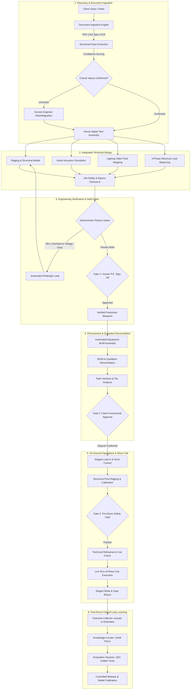

# Eventology Technical Production AI Architecture Proposal
## Systems Architecture Specification — Target State & Baseline Evolution

**Document Identifier:** `EVENTOLOGY-ARCH-PROP-2026-V1`  
**Classification:** Internal Technical Architecture Specification  
**Status:** PROPOSED (Architecture Baseline Specification)  
**Target Stack:** Node.js, TypeScript 5.x, Express 5.x, LangGraph.js 1.4+, Firestore, Firebase Auth, Flutter  

---

### Executive Summary

Eventology is evolving from a consumer event-planning concierge into an **enterprise-grade, AI-assisted technical event-production operating system**. While the current implementation successfully orchestrates preliminary consumer discovery, basic service category matching, and human-in-the-loop booking interrupts across 11 early-stage agents, it treats complex physical production disciplines—such as acoustics, rigging physics, three-phase power distribution, venue ingress logistics, and life-safety compliance—as generic service catalog queries.

This architecture specification defines a rigorous, dependable, multi-agent technical production platform. It retains the proven strengths of the existing stack (LangGraph.js statecharts, custom Firestore checkpointer, Firebase authentication boundaries, and Flutter dual-mode clients) while introducing formal engineering contracts, strict provenance tracking, physical safety hold points, and a controlled self-improvement pipeline.

---

### 1. Current Verified Architecture vs. Documented Baseline

Based on direct source-code inspection of `d:\Projects\Eventology\eventology_backend` and `eventology_app`, the actual architectural reality of Eventology is characterized as follows:

```
                               CURRENT RUNTIME TOPOLOGY
                               
   Flutter App (GoRouter)                  WhatsApp / Meta Webhook
   ├── Five-Step Flow (ai_routes.ts)       └── HMAC SHA-256 (whatsapp_routes.ts)
   └── Conversational AI (agent_routes.ts)              │
                    │                                   ▼
                    ▼                      whatsapp_agent_bridge.ts
     Express 5.2 Server (index.ts)                      │
     ├── Bearer Auth (Firebase ID Token)                │
     └── /api/agent/chat ───────────────────────────────┘
                    │
                    ▼
          eventologyAgentApp (LangGraph StateGraph)
                    │
                    ├─► [orchestrator_agent] (Deterministic router + LLM Reassessment)
                    │         │
                    │         ├─► [event_intake_agent] (tools: get_event_types, get_locations)
                    │         ├─► [event_planning_agent] (tools: get_categories, get_packages)
                    │         ├─► PARALLEL FAN-OUT (Send[])
                    │         │     ├─► [venue_agent] (tools: search_venues, get_venue_details)
                    │         │     ├─► [vendor_agent] (tools: search_vendors_by_service)
                    │         │     └─► [service_agent] (tools: get_services_by_category)
                    │         ├─► [availability_agent] (tools: check_venue/vendor_availability)
                    │         ├─► [budget_agent] (tools: get_venue/vendor/package_pricing)
                    │         ├─► [approval_agent] (interrupt() -> suspended state)
                    │         ├─► [booking_agent] (tools: create_event, create_booking, allocations)
                    │         └─► [communication_agent] (tools: create_notification)
                    │
                    ▼
          Firestore Checkpointer (_agent_checkpoints/{thread_id}/checkpoints/{id})
```

#### Detailed Findings by Subsystem:

1. **LangGraph Graph Definition & Routing (`src/graph/index.ts`, `src/graph/routing.ts`):**
   - *Verified in Source:* The graph compiles via `workflow.compile({ checkpointer })` in `src/graph/index.ts`. It registers 11 agent nodes. The routing is centralized through conditional edge `orchestratorRoute`.
   - *Parallel Fan-out:* `orchestratorRoute` returns `Send[]` for `specialist_search`, running `venue_agent`, `vendor_agent`, and `service_agent` in parallel.
   - *Mismatch/Dead Code:* `src/graph/routing.ts` defines an `orchestratorRouter` function that is completely unused by `src/graph/index.ts`. It only routes between `event_intake` and `event_planning` and terminates on everything else.

2. **State Management & Annotations (`src/graph/state.ts`):**
   - *Verified in Source:* Built using LangGraph `Annotation.Root`. Includes reducers for `conversationHistory` (`messagesStateReducer`), `eventRequirements` (shallow merge), `createdEnquiryIds`, `createdBookingIds`, `completedTasks`, and `agentHistory` (concatenation).
   - *Limitation:* The state lacks schema validation at runtime (Zod is used inside individual agent files for tool outputs, but state transitions are untyped JavaScript objects). There is no concept of data provenance (who asserted a fact, when it was verified, confidence levels, or distinguishing measured constraints from assumptions).

3. **Checkpointing & Persistence (`src/services/firestore_checkpointer.ts`):**
   - *Verified in Source:* A custom `FirestoreCheckpointer` extends `BaseCheckpointSaver` from `@langchain/langgraph-checkpoint`. It correctly serializes checkpoints using `serde.dumpsTyped` and writes to `_agent_checkpoints/{thread_id}/checkpoints/{checkpoint_id}` and `writes/{task_id}_{idx}`.
   - *Verification Evidence:* Handled seamlessly with resume capabilities on interrupt.

4. **Human-in-the-Loop Interrupts (`src/agents/approval_agent.ts`, `src/api/agent_routes.ts`):**
   - *Verified in Source:* The approval mechanism uses LangGraph's native `interrupt()` function. When `approval_agent` runs, it halts execution, persists the state, and returns `pending_user` to the client. Resumption is triggered via `POST /api/agent/approve` using `new Command({ resume: { approved, note } })`.
   - *Hard Gate Verified:* `booking_agent.ts` explicitly enforces that `state.approvalStatus === "approved"`; if not, it logs an error and refuses to execute booking writes.

5. **LLM Provider Configuration (`src/llm/provider.ts`):**
   - *Verified in Source:* Single factory function `getLLMProvider()`. Defaults to OpenRouter (`ChatOpenAI` targeting `https://openrouter.ai/api/v1` with model `openai/gpt-4o-mini`), falling back to `ChatGoogleGenerativeAI` (`gemini-3.8-flash`).
   - *Limitation:* No model routing based on task complexity (e.g., lightweight deterministic extraction vs. complex physics reasoning).

6. **Authentication & Authorization (`src/middleware/auth.ts`, `src/api/admin_routes.ts`):**
   - *Verified in Source:* Firebase Auth ID tokens decoded in `verifyFirebaseToken`. Decoded token attached to `req.user`. Admin routes strictly require `decodedToken.role === "admin"`.
   - *Verification Evidence:* Multi-tenant separation is partially enforced by matching `stateSnapshot.values.userId !== req.user.uid` in `agent_routes.ts`.

7. **Database Collections & Relationships (`src/scripts/verify*.ts`):**
   - *Verified in Source:* Collections include `users`, `events`, `venues`, `venueTypes`, `vendors`, `categories`, `services`, `packages`, `allocations`, `bookings`, `enquiries`, `notifications`, `payments`, `reviews`, `agent_tasks`, `agent_logs`, `audit_logs`, `chat_handoffs`, and `_agent_checkpoints`.
   - *Relational Integrity:* Verified via 25 test/verification scripts in `src/scripts/`.

8. **Dual User Experience Integration (`eventology_app`):**
   - *Verified in Source:* 
     - **Five-Step Planner:** `ai_planner_flow_screen.dart` calls `/api/ai/generate-event-plan` (`src/api/ai_routes.ts`), which is a standalone prompt that outputs a JSON summary. It bypasses LangGraph entirely and pushes to `ai_generated_plan_screen.dart`, which uses hardcoded local vendor toggles.
     - **AI Chat Screen:** `ai_chat_screen.dart` calls `/api/agent/chat` (`src/api/agent_routes.ts`), fully interacting with LangGraph and displaying structured approval cards.

---

### 2. The Architectural Gap: Planning vs. Technical Production

The existing system operates under an **e-commerce booking model**:
$$\text{User Brief} \longrightarrow \text{Keyword Match} \longrightarrow \text{Category Listing} \longrightarrow \text{Price Summation} \longrightarrow \text{Booking}$$

However, high-stakes physical events (concerts, corporate summits, high-profile weddings, broadcast galas) operate under an **engineering production model**:
$$\text{Creative Vision} \longrightarrow \text{Venue Physics \& Constraints} \longrightarrow \text{Technical Disciplines (A/V, Rigging, Power)} \longrightarrow \text{Safety Verification} \longrightarrow \text{Procurement \& Ops}$$

#### Critical Flaws in the Existing Model for Technical Production:
1. **Lack of Physical Grounding:** A venue is queried only by guest capacity and base price. Ceiling trim height, floor load bearing ($kN/m^2$), hanging point working load limits (WLL), 3-phase power availability (amps per phase, camlock terminations), and dock access dimensions are completely absent.
2. **Missing Engineering Disciplines:** A/V is treated as a generic service tag ("Photography", "Sound & Lighting"). There is no calculation of acoustic coverage, speaker throw, line arrays, projector lumens vs. ambient lux, LED video wall pitch and aspect ratios, DMX/ArtNet universe counts, or rigging bridles.
3. **No Safety & Regulatory Accountability:** No agent evaluates fire exit egress width, crowd crush limits, evacuation transit times, structural certificates, temporary structure wind ratings, or required municipality permits.
4. **Coarse Invalidation:** If a user changes the venue or guest count mid-workflow, `orchestrator_agent.ts` uses an LLM call to guess which stages are invalidated, which then nukes entire arrays indiscriminately rather than tracing a targeted directed acyclic graph (DAG) of technical dependencies.

---

### 3. Proposed Target Architecture

The target architecture establishes an **Enterprise Technical Production AI Operating System**. It preserves the LangGraph.js framework, Express server, and Firestore database while introducing a specialized **Technical Production Graph** governed by strict engineering contracts and validation gates.

```
══════════════════════════════════════════════════════════════════════════════════════════════════════
                                  EVENTOLOGY TARGET AI ARCHITECTURE
══════════════════════════════════════════════════════════════════════════════════════════════════════

      ┌───────────────────────────┐                     ┌───────────────────────────┐
      │   Five-Step UX Stream     │                     │     AI Chat UX Stream     │
      │ (ai_planner_flow_screen)  │                     │     (ai_chat_screen)      │
      └─────────────┬─────────────┘                     └─────────────┬─────────────┘
                    │                                                 │
                    │      ┌───────────────────────────────────┐      │
                    └─────►│   Unified Production Gateway      │◄─────┘
                           │   /api/production/workflow        │
                           └─────────────────┬─────────────────┘
                                             ▼
       ═══════════════════════════════════════════════════════════════════════════════════════
       LANGGRAPH.JS TECHNICAL PRODUCTION RUNTIME (eventologyProductionApp)
       ═══════════════════════════════════════════════════════════════════════════════════════
                                             │
                                             ▼
                             ┌───────────────────────────────┐
                             │    PRODUCTION ORCHESTRATOR    │
                             │   - Deterministic State DAG   │
                             │   - Invalidation Controller   │
                             │   - Safety Hold Point Monitor │
                             └───────────────┬───────────────┘
                                             │
             ┌───────────────────────────────┴──────────────────────────────┐
             ▼                                                              ▼
   ┌───────────────────┐                                          ┌───────────────────┐
   │   EVENT CURATOR   │                                          │ VENUE ENGINEERING │
   │ - Creative Brief  │                                          │ - Physical Specs  │
   │ - Run-of-Show Req │                                          │ - Power/Load Caps │
   └─────────┬─────────┘                                          └─────────┬─────────┘
             │                                                              │
             └───────────────────────┬──────────────────────────────────────┘
                                     │
                                     ▼
                   ┌───────────────────────────────────┐
                   │    DISCIPLINE FAN-OUT ENGINE      │
                   │    (Deterministic Dependency Run) │
                   └─────────────────┬─────────────────┘
                                     │
         ┌───────────────────────────┼───────────────────────────┐
         ▼                           ▼                           ▼
┌───────────────────┐       ┌───────────────────┐       ┌───────────────────┐
│  A/V ENGINEERING  │       │RIGGING ENGINEERING│       │ SAFETY & SECURITY │
│ - Audio / SPL Map │◄─────►│ - Load Dist. (kN) │◄─────►│ - Egress Modeling │
│ - Video / Pixels  │       │ - Truss Trim/WLL  │       │ - Life-Safety Reg │
│ - 3-Phase Power   │       │ - PE Review Reqs  │       │ - Permit Tracking │
└─────────┬─────────┘       └─────────┬─────────┘       └─────────┬─────────┘
          │                           │                           │
          └───────────────────────────┼───────────────────────────┘
                                      │
                                      ▼
                        ┌───────────────────────────┐
                        │    VALIDATION & AUDIT     │
                        │    DETERMINISTIC GATES    │
                        └─────────────┬─────────────┘
                                      │
                        ┌─────────────┴─────────────┐
                        ▼                           ▼
             [Critical Safety Block?]     [Compliant Engineering?]
                        │                           │
             Yes ───────┘                           └───────► Proceed to:
             │                                                ┌───────────────────┐
             ▼                                                │VENDOR/PROCUREMENT │
     ┌───────────────────────────┐                            │ - Technical Scope │
     │  SAFETY HOLD INTERRUPT    │                            │ - Line-Item Specs │
     │  Requires Human P.E. /    │                            └─────────┬─────────┘
     │  Lead Rigger Sign-off     │                                      │
     └───────────────────────────┘                                      ▼
                                                              ┌───────────────────┐
                                                              │BUDGET & SCHEDULE  │
                                                              │- Time-Phased Ops  │
                                                              │- Variance Guard   │
                                                              └───────────────────┘
```

---

### 4. Agent Responsibility Matrix

The redesign transitions from functional silos (e.g. "service agent" vs "vendor agent") into **professional engineering disciplines**:

| Role / Agent Name | Core Technical Deliverables | Critical Inputs | Tools & Authorities | What It Must NEVER Do |
| :--- | :--- | :--- | :--- | :--- |
| **Production Orchestrator** | Dependency graph resolution, invalidation propagation, state versioning, routing, lifecycle transitions. | Updated event requirements, domain change events, interrupt responses. | State graph router, Firestore checkpointer, invalidation engine. | **Never approve safety exceptions, fabricate engineering sign-offs, or bypass human review.** |
| **Event Curator** | Creative brief, spatial theme, audience journey, programming segments, Run-of-Show (ROS) timing cues. | User vision, event type, guest profile, cultural traditions, artist riders. | Cultural template DB, ROS scheduling tools, experience design rubrics. | **Never override electrical, weight, or egress limits set by engineering agents.** |
| **Venue Engineering** | Verified venue envelope, rigging point map, 3-phase power schedule, loading dock clearance, floor load ratings. | Venue ID, architectural CAD/PDF metadata, site survey reports. | `get_venue_technical_spec`, `verify_dock_access`, `get_power_distribution`. | **Never assume unverified structural ratings or accept verbal venue assurances.** |
| **A/V Engineering** | Audio SPL distribution, video raster/pixel maps, DMX universe schedules, 3-phase power load sheets (kVA). | Curator ROS, Venue spatial bounds, audience geometry, equipment spec sheets. | `calculate_spl_coverage`, `compute_power_draw`, `lookup_av_inventory`. | **Never specify power exceeding venue breaker ratings without specifying supplementary generators.** |
| **Rigging Engineering** | Truss geometry, bridle load calculations, hanging point reactions, motor schedules, dynamic load safety factors. | A/V lighting/audio equipment weights, Venue point limits, trim heights. | `calculate_bridle_tension`, `verify_point_wll`, `check_structural_envelope`. | **Never fabricate hanging capacities, approve dead-hangs without structural data, or certify WLL.** |
| **Safety & Security Inspector** | Life-safety hazard register, egress capacity checks, fire marshal permit checklist, security staffing ratios. | Guest count, floor plan layout, pyrotechnics/fog intent, local municipal code. | `evaluate_egress_width`, `check_hazard_matrix`, `verify_permit_checklist`. | **Never clear an event with blocked exits, overloaded venues, or uncertified rigging structures.** |
| **Vendor & Procurement** | Verified technical scopes of work (SOW), equipment bill of materials (BOM), quotation reconciliation, crew rosters. | Approved engineering BOMs, vendor inventory catalogs, SLA requirements. | `query_vendor_inventory`, `generate_technical_sow`, `reconcile_quote`. | **Never substitute technical gear without engineering agent verification of specs.** |

---

### 5. Deterministic Services vs. Autonomous Agents

To guarantee system stability and prevent non-deterministic hallucination in safety and financial matters, the following functions are modeled strictly as **Deterministic Services**, not LLM agents:

1. **Load Distribution & Structural Calculation Service:**
   - Pure mathematical calculations for beam bending moments, bridle tensions, and point reaction forces ($T = \frac{W \cdot d_2}{L \cdot \sin(\theta)}$).
   - An LLM must format the equipment weight inputs, but the calculation engine is deterministic code with zero float variance.
2. **Electrical Load Aggregation & Phase Balancing Service:**
   - Summation of active wattage ($W$) and apparent power ($VA$) per phase ($L_1, L_2, L_3$).
   - Computes neutral conductor current and flags imbalances exceeding $20\%$.
3. **Egress Capacity & Fire Transit Evaluator:**
   - Deterministic implementation of NFPA 101 / National Building Code (NBC) India egress metrics (e.g. 5mm width per person for stairways, 3.8mm per person for level corridors).
4. **Stale Result Invalidation Graph Engine:**
   - Deterministic topological sort over the dependency graph. When a node changes (e.g., `Venue`), all descendant nodes are automatically invalidated without asking an LLM.

---

### 6. Technical Production Lifecycle Workflow

The lifecycle covers the end-to-end event continuum, structured into three distinct phases with explicit gate conditions:

```mermaid
graph TD
    subgraph Pre_Production ["Phase 1: Pre-Production"]
        Brief[1.1 Event Brief & Creative Vision] --> VenueFeas[1.2 Venue Technical Feasibility]
        VenueFeas --> EngDesign[1.3 Integrated Technical Design: A/V, Rigging, Power]
        EngDesign --> SafetyCheck[1.4 Safety & Egress Audit]
        SafetyCheck -->|Passed| TechReview{Gate 1: Human Technical Review}
        SafetyCheck -->|Violations| EngDesign
        TechReview -->|Approved| Procure[1.5 Vendor SOW & Procurement]
        Procure --> BudgetSched[1.6 Master Production Schedule & Budget]
        BudgetSched --> ClientSignoff{Gate 2: Client Commercial Approval}
    end

    subgraph On_Ground ["Phase 2: On-Ground Production"]
        ClientSignoff -->|Confirmed| LoadIn[2.1 Staged Load-In & Rigging Point Check]
        LoadIn --> TechSetup[2.2 Audio/Video/Lighting Setup & Calibration]
        TechSetup --> SafetyHold{Gate 3: Pre-Doors Safety Hold Point}
        SafetyHold -->|Sign-off Passed| Rehearsal[2.3 Technical Rehearsal & Cue Check]
        Rehearsal --> ShowExec[2.4 Show Call & Live Run-of-Show]
        ShowExec --> Strike[2.5 Staged Load-Out & Egress Strike]
    end

    subgraph Post_Production ["Phase 3: Post-Production"]
        Strike --> GearReturn[3.1 Asset Inspection & Gear Reconciliation]
        GearReturn --> FinancialRecon[3.2 Planned vs Actual Cost Audit]
        FinancialRecon --> IncidentAnalysis[3.3 Issue, Risk & Near-Miss Log]
        IncidentAnalysis --> LessonsLearned[3.4 Outcome Ingestion to Knowledge Base]
    end
```



#### Change Propagation & Invalidation Example:
Suppose the client changes the venue from *Mayfair Lake Resort Banquet* to *Courtyard Marriott Indoor Hall* after technical designs have been completed:
1. **Trigger:** `orchestrator` detects change in `state.venueSpecification.venueId`.
2. **Deterministic Invalidation Pipeline:**
   - `state.venueSpecification` $\rightarrow$ **INVALIDATED** (Reloads ceiling height from 8.5m down to 4.2m).
   - `state.riggingSpecification` $\rightarrow$ **INVALIDATED** (Previous 8-meter high box truss impossible; motor hanging points restricted to ceiling unistrut).
   - `state.avSpecification` $\rightarrow$ **INVALIDATED** (Line array audio inappropriate; video wall height must be reduced from 5m to 3m; acoustic throw profile recomputed).
   - `state.safetySpecification` $\rightarrow$ **INVALIDATED** (Egress doors change from 4 double doors to 2 standard exits; maximum permissible occupancy drops).
   - `state.vendorProcurement` $\rightarrow$ **STALE** (Ground support truss required instead of suspended motors; high-power subwoofers canceled).
   - `state.budgetBreakdown` $\rightarrow$ **INVALIDATED** (Equipment costs drop, rigging labor increases due to ground support build time).
3. **Re-execution Sequence:**
   - The Orchestrator schedules: `Venue Engineering` $\rightarrow$ `A/V & Rigging in Parallel` $\rightarrow$ `Safety Inspector` $\rightarrow$ `Vendor Procurement` $\rightarrow$ `Budget & Master Schedule`.
   - Any previous human approval is marked `REVOKED_DUE_TO_CHANGE` and requires re-affirmation.

---

### 7. Existing Components to Preserve vs. Proposed Components

```
┌────────────────────────────────────────────────────────────────────────────────────────┐
│                                EXISTING COMPONENTS TO PRESERVE                         │
├────────────────────────────────┬───────────────────────────────────────────────────────┤
│ Component                      │ Architectural Rationale                               │
├────────────────────────────────┼───────────────────────────────────────────────────────┤
│ LangGraph.js Runtime           │ Native support for cycles, interrupts, and complex    │
│ (@langchain/langgraph 1.4+)    │ statecharts. No limitation warrants replacement.     │
├────────────────────────────────┼───────────────────────────────────────────────────────┤
│ FirestoreCheckpointer          │ Fully functioning production checkpoint saver that     │
│ (src/services/firestore_...)   │ integrates directly with LangGraph thread persistence.│
├────────────────────────────────┼───────────────────────────────────────────────────────┤
│ Firebase Authentication & Auth │ Production-tested token validation, custom claims     │
│ Middleware (src/middleware/...)│ (role: admin, vendor), and tenant isolation.          │
├────────────────────────────────┼───────────────────────────────────────────────────────┤
│ Firestore Document Base        │ Core collections (events, venues, vendors, bookings,  │
│ (events, venues, bookings)     │ allocations) are verified and have active UI links.   │
├────────────────────────────────┼───────────────────────────────────────────────────────┤
│ Razorpay Payment Engine        │ Complete payment order and webhook signature          │
│ (src/api/payment_routes.ts)    │ verification pipelines.                               │
├────────────────────────────────┼───────────────────────────────────────────────────────┤
│ WhatsApp Webhook & Bridge      │ HMAC signature validation, user identity resolution,  │
│ (src/api/whatsapp_routes.ts)   │ and conversation thread linkage.                      │
└────────────────────────────────┴───────────────────────────────────────────────────────┘

┌────────────────────────────────────────────────────────────────────────────────────────┐
│                              PROPOSED NEW & UPGRADED COMPONENTS                        │
├────────────────────────────────┬───────────────────────────────────────────────────────┤
│ Component                      │ Purpose & Architectural Rationale                     │
├────────────────────────────────┼───────────────────────────────────────────────────────┤
│ Technical Production State     │ Strict, versioned Zod state schema distinguishing     │
│ (`ProductionGraphState`)       │ Facts, Assumptions, Calculations, and Approvals.      │
├────────────────────────────────┼───────────────────────────────────────────────────────┤
│ Technical Specialist Agents    │ A/V Engineering, Rigging Engineering, Safety/Security,│
│ (AV, Rigging, Safety, Venue)   │ replacing broad, shallow planning agents.             │
├────────────────────────────────┼───────────────────────────────────────────────────────┤
│ Deterministic Physics Services │ Rigging bridle calculation, phase-balanced power      │
│ (Rigging, Power, Egress)       │ distribution, and egress width verification.          │
├────────────────────────────────┼───────────────────────────────────────────────────────┤
│ Safety Hold Gate Controller    │ Native LangGraph interrupt nodes specifically bound to│
│ (Physical Safety Gates)        │ structural, electrical, and life-safety sign-offs.    │
├────────────────────────────────┼───────────────────────────────────────────────────────┤
│ Technical SOW & BOM Generator  │ Direct conversion of approved engineering specs into  │
│ (Engineering to Procurement)   │ line-item vendor requests with zero manual drift.     │
├────────────────────────────────┼───────────────────────────────────────────────────────┤
│ Closed-Loop Self-Improvement   │ Outcome Collector, Knowledge Curator, Evaluation      │
│ Pipeline (A-F Architecture)    │ Harness, and Controlled Release Manager.              │
└────────────────────────────────┴───────────────────────────────────────────────────────┘
```

---

### 8. Engineering Domain Models & Deliverable Specifications

Eventology transitions from generic category matching to an **engineering-grade event-production operating system**. The six technical domains below represent **formal deterministic engineering models**, not independent LLMs. Each model possesses a strict schema, mathematical verification rules, source provenance tracking, and actionable deliverable artifacts.

```
══════════════════════════════════════════════════════════════════════════════════════════════════════
                                    SIX CORE ENGINEERING MODELS
══════════════════════════════════════════════════════════════════════════════════════════════════════

   ┌───────────────────────────┐      ┌───────────────────────────┐      ┌───────────────────────────┐
   │    VENUE DIGITAL TWIN     │      │   RIGGING & STRUCTURAL    │      │    AUDIO & ACOUSTICS      │
   │  - Scaled Boundaries      │      │  - Bridle Vector Math     │      │  - SPL Coverage Contours  │
   │  - 3D Obstructions & Trim │      │  - Point WLL Reaction     │      │  - Line Array Trim Angles │
   │  - Floor Load (kN/m²)     │      │  - Center of Gravity      │      │  - Delay Alignment (ms)   │
   │  - Dock Clearances        │      │  - Assumption Register    │      │  - Curfew dBA Constraints │
   └─────────────┬─────────────┘      └─────────────┬─────────────┘      └─────────────┬─────────────┘
                 │                                  │                                  │
                 └──────────────────────────────────┼──────────────────────────────────┘
                                                    │
                 ┌──────────────────────────────────┴──────────────────────────────────┐
                 │                                  │                                  │
   ┌─────────────▼─────────────┐      ┌─────────────▼─────────────┐      ┌─────────────▼─────────────┐
   │  LIGHTING, VIDEO & DISPLAY│      │  ELECTRICAL DISTRIBUTION  │      │ CROWD FLOW & LIFE-SAFETY  │
   │  - Fixture Coordinates    │      │  - 3-Phase Amps (L1,L2,L3)│      │  - Occupant Density (m²)  │
   │  - Projector Throw/Lux    │      │  - Neutral Load & Balance │      │  - Exit Widths (mm/person)│
   │  - LED Pixel Pitch/Aspect │      │  - Voltage Drop (ΔV)      │      │  - Egress Travel Times    │
   │  - DMX/Art-Net Universes  │      │  - Single-Line Diagrams   │      │  - Municipal Code Holds   │
   └───────────────────────────┘      └───────────────────────────┘      └───────────────────────────┘
```

#### 8.1 Model 1: Venue Digital Twin
- **Data Model:**
  - `boundaryGeometry`: 2D polygon vertices $(x, y)$ in millimeters, ceiling height map $z(x, y)$, obstruction volumes (pillars, chandeliers, low soffits, HVAC ducts).
  - `structuralGrid`: Array of certified ceiling attachment points $(x, y, z)$ with verified Working Load Limit (WLL in $kg$), structural beam axis, floor load bearing capacity ($kN/m^2$).
  - `spatialZones`: Stage location, back-of-house (BOH), front-of-house (FOH) mix position, audience seating blocks, accessible routes (ADA/disability compliance).
  - `logisticalAccess`: Loading dock roll-up door clearance $(W \times H)$, dock leveler presence, freight elevator dimensions, max payload capacity ($kg$), ramp gradient, truck turning radii.
- **Deterministic Math & Rules:**
  - Coordinate bounding-box collision detection: fixtures and structures cannot intersect obstruction volumes.
  - Floor loading check: $\sum \frac{\text{Equipment Weight} + \text{Live Dynamic Load}}{\text{Footprint Area}} \le \text{Venue Floor Limit } (kN/m^2)$.
- **Output Artifacts:**
  - Scaled vector floor plans (SVG), DXF layer export, venue physical feasibility scorecard, and CAD/BIM metadata overlays.

#### 8.2 Model 2: Rigging & Structural Load Model
- **Data Model:**
  - `trussAssemblies`: Spans, cross-sections (e.g. 30.5cm box truss), self-weight, manufacturer deflection curves.
  - `hoistsAndMotors`: Point locations, motor ratings (e.g. 1/2 ton, 1 ton, 2 ton), hoist chain self-weight, motor controller channels.
  - `suspendedEquipment`: Fixture, audio cluster, and video tile point loads with $(x, y, z)$ coordinates and centers of gravity.
  - `bridleGeometry`: Apex coordinates, leg lengths, horizontal offset distances ($d_1, d_2$), bridle angles ($\theta_1, \theta_2$).
- **Deterministic Math & Rules:**
  - Bridle tension formula: $T_1 = \frac{W \cdot d_2}{L \cdot \sin(\theta_1)}$, $T_2 = \frac{W \cdot d_1}{L \cdot \sin(\theta_2)}$.
  - Angle safety gate: Reject any bridle angle $\theta < 30^\circ$ or $> 120^\circ$ apex angle without certified engineer waiver.
  - Dynamic safety factor: Dynamic load factor of $1.25\times$ to $2.0\times$ applied based on motorized movement.
  - Point reaction summation: $\sum T_{\text{point}} \le \text{Venue WLL}$. If point reaction exceeds WLL, trigger **STRUCTURAL_HOLD**.
- **Output Artifacts:**
  - Rigging plot with coordinate schedules, motor point-load table, assumption register, and unresolved structural check alerts.

#### 8.3 Model 3: Audio & Acoustics Model
- **Data Model:**
  - `audienceArea`: Surface geometry, seated ear height ($1.1m$), standing ear height ($1.6m$), rake angle/sloped seating.
  - `speakerArrays`: Main PA, out-fill, front-fill, and subwoofer cluster coordinates $(x, y, z)$, splay angles, trim height, manufacturer directivity data (horizontal $\times$ vertical $Q$).
  - `delayTowers`: Tower coordinates, target delay time ($ms$), temperature and humidity atmospheric compensation.
  - `noiseConstraints`: Local municipal curfew dB limits, maximum permissible dBA $L_{\text{eq}}$ and peak dBC at property boundaries.
- **Deterministic Math & Rules:**
  - Inverse square law attenuation: $\text{SPL}_2 = \text{SPL}_1 - 20 \log_{10}\left(\frac{d_2}{d_1}\right) - \alpha_{\text{air}}(f) \cdot d$.
  - Acoustic delay calculation: $\Delta t = \frac{d_{\text{delay}} - d_{\text{main}}}{c_{\text{sound}}}$, where $c_{\text{sound}} = 331.3 \sqrt{1 + \frac{T^\circ\text{C}}{273.15}} \text{ m/s}$.
  - Coverage variance threshold: Flag uneven audience coverage where $\Delta\text{SPL} > \pm 3.0\text{ dBA}$ across listening plane.
- **Output Artifacts:**
  - Acoustic coverage contour map, speaker placement coordinate sheet, delay alignment schedule, and environmental noise compliance disclaimer.

#### 8.4 Model 4: Lighting, Video & Display Model
- **Data Model:**
  - `fixtures`: Coordinates $(x, y, z)$, fixture type (profile, wash, beam, strobe), beam angle, field angle, wattage, weight.
  - `dmxUniverses`: Universe assignment (1–512 channels per universe), Art-Net/sACN IP node routing, DMX footprint per fixture.
  - `videoDisplays`: LED wall width, height, resolution, pixel pitch ($mm$), module weight, panel power consumption (average and peak), processing raster map.
  - `projection`: Screen dimensions, gain, projector throw distance, projector ANSI lumens, ambient lux environment.
- **Deterministic Math & Rules:**
  - Video resolution & viewing distance: $\text{Min Viewing Distance} = \text{Pixel Pitch (mm)} \times 1.0\text{ m}$; $\text{Optimal Distance} = \text{Pixel Pitch} \times 2.5\text{ m}$.
  - Projection brightness ratio: $\text{Screen Lux} = \frac{\text{Projector Lumens}}{\text{Screen Area }(m^2)} \ge 5\times \text{Ambient Lux}$ for acceptable contrast.
  - Universe capacity validation: $\sum \text{DMX Channels per Universe} \le 512$; auto-allocate additional Art-Net universes when channel count overflows.
- **Output Artifacts:**
  - Lighting plot, fixture schedule, DMX patch sheet, video raster map, and optical throw verification sheet.

#### 8.5 Model 5: Electrical Distribution Model
- **Data Model:**
  - `distributionBoards`: Location, main breaker rating (e.g. 63A, 125A, 250A, 400A), 3-phase supply (230V line-to-neutral, 415V line-to-line, 50Hz IST).
  - `circuits`: Circuit ID, breaker amperage (16A, 32A), phase assignment ($L_1, L_2, L_3$), cable cross-section ($mm^2$), cable length ($m$).
  - `connectedLoads`: Active wattage ($W$), power factor ($\cos\phi$), apparent power ($VA$).
- **Deterministic Math & Rules:**
  - Phase current per phase: $I_{\text{phase}} = \frac{\sum P_{\text{phase}}}{V_{\text{phase}} \cdot \cos\phi}$.
  - Neutral conductor current calculation:
    $$I_N = \sqrt{I_1^2 + I_2^2 + I_3^2 - (I_1 \cdot I_2) - (I_2 \cdot I_3) - (I_3 \cdot I_1)}$$
  - Phase imbalance threshold: $\frac{\max(I_1, I_2, I_3) - \min(I_1, I_2, I_3)}{\text{Average}(I_1, I_2, I_3)} \times 100\% \le 20\%$. Flag violation if $> 20\%$.
  - Voltage drop calculation: $\Delta V = \frac{2 \cdot I \cdot L \cdot \rho}{A}$ (single-phase) or $\frac{\sqrt{3} \cdot I \cdot L \cdot \rho}{A}$ (three-phase); reject if $\Delta V > 3.0\%$.
  - Generator sizing: Generator $\text{kVA} = \frac{\text{Total Peak } kVA \times 1.25 \text{ (Headroom Factor)}}{\text{Generator Power Factor (0.8)}}$.
- **Output Artifacts:**
  - Electrical load schedule, phase balancing calculation report, breaker allocation matrix, and preliminary Single-Line Diagram (SLD).

#### 8.6 Model 6: Crowd Flow and Life-Safety Model
- **Data Model:**
  - `occupancy`: Guest count, performer count, crew/staff count, total occupant load.
  - `exits`: Exit door locations, clear door leaf width ($mm$), outward swing verification, panic hardware status.
  - `routes`: Primary and secondary egress corridor widths, dead-end corridor lengths, travel distances to nearest exit.
  - `fireSafety`: Extinguisher placements, sprinkler coverage, fire marshal lane clearance, flame-retardant fabric cert status.
- **Deterministic Math & Rules:**
  - Occupant density allowance (NBC India / NFPA 101): Assembly standing space $\ge 0.65\text{ m}^2/\text{person}$; assembly seated tables $\ge 1.4\text{ m}^2/\text{person}$.
  - Egress width capacity: Exit door width $\ge \text{Occupants} \times 5.0\text{ mm/person}$; Level corridor width $\ge \text{Occupants} \times 3.8\text{ mm/person}$. Minimum clear exit door width is $1000\text{ mm}$.
  - Maximum travel distance: Common path of travel $\le 23.0\text{ m}$; total travel distance to exit $\le 45.0\text{ m}$ (unsprinklered) or $60.0\text{ m}$ (sprinklered).
  - Clear aisle maintenance: Seating rows must maintain minimum $300\text{ mm}$ clear passage between chair backs and front of following row.
- **Output Artifacts:**
  - Life-safety circulation plan, egress width capacity compliance report, hazard matrix, and municipal fire marshal permit checklist.

#### 8.7 Production Schedule & Logistics Model
- **Data Model:**
  - `logisticsWindows`: Venue access load-in window (start/end timestamp), load-out strike window, dock arrival slots per truck.
  - `transportFleet`: Vehicle class (e.g. 14ft container, 22ft multi-axle), delivery manifests, equipment volume ($m^3$) and weight ($kg$).
  - `crewRosters`: Department calls (Rigging, Audio, Video, Lighting, Scenic, Stage Management), call times, shift durations, mandatory meal breaks.
  - `timelineDependencies`: Predecessor tasks (e.g., *Truss cannot fly until audio clusters are attached*; *Audio line check cannot begin until power distro is certified*).
  - `runOfShowCues`: Cue number, timestamp, cue call, visual cue, audio preset, lighting scene, stage talent movement.
- **Deterministic Math & Rules:**
  - Critical path method (CPM) analysis: Calculate earliest/latest start times, slack/float, and critical path duration.
  - Turnaround and shift limits: Enforce minimum 8-hour crew turnaround between strike and morning load-in; block over-time labor violations without administrative override.
- **Output Artifacts:**
  - Master production timeline, truck dock loading schedule, department call sheets, and technical Run-of-Show (ROS) cue sheet.

#### 8.8 Equipment & Technical Knowledge Catalog
- **Data Model:**
  - Canonical manufacturer records (e.g. L-Acoustics, d&b audiotechnik, Robe, MA Lighting, Christie, Absen, Tomcat Truss, CM Lodestar).
  - Dimensions $(L \times W \times H)$, net weight, flying weight, mounting orientation, center of gravity offsets.
  - Electrical specs: operating voltage, idle wattage, peak current, power factor, connector types (True1, Socapex, Camlock).
  - Acoustic & optical specs: directivity tables, frequency response, lumens, lux output curves, beam angles.
  - Provenance anchors: source datasheet PDF, date verified, manufacturer certification status.

---

### 9. Omnichannel Identity, Conversation & Artifact Delivery Architecture

Eventology is engineered as a **unified multi-channel AI production operating system**. Users can initiate discovery via social channels (Instagram, WhatsApp) and seamlessly continue into the full-featured Flutter workspace without losing conversation context, event requirements, or generated deliverables.

```
══════════════════════════════════════════════════════════════════════════════════════════════════════
                                  OMNICHANNEL SYSTEM TOPOLOGY
══════════════════════════════════════════════════════════════════════════════════════════════════════

   ┌───────────────────────────┐      ┌───────────────────────────┐      ┌───────────────────────────┐
   │      EVENTOLOGY APP       │      │         WHATSAPP          │      │         INSTAGRAM         │
   │  - Full Flutter Workspace │      │  - Meta Cloud API         │      │  - Instagram Graph API    │
   │  - Dual-Pane Canvas/CAD   │      │  - WhatsApp Agent Bridge  │      │  - Messenger Discovery    │
   │  - Firebase Auth Session  │      │  - E.164 Phone Identity   │      │  - IG-Scoped ID (IGSID)   │
   └─────────────┬─────────────┘      └─────────────┬─────────────┘      └─────────────┬─────────────┘
                 │                                  │                                  │
                 │                     ┌────────────┴────────────┐                     │
                 │                     ▼                         ▼                     │
                 │          ┌───────────────────────────────────────────┐              │
                 └─────────►│         CHANNEL INTEGRATION LAYER         │◄─────────────┘
                            │  - Webhook HMAC SHA-256 Signature Auth    │
                            │  - Message Envelope Normalization         │
                            │  - Identity Resolution & Linking Store    │
                            │  - Conversation Routing & Mapping         │
                            └─────────────────────┬─────────────────────┘
                                                  │
                                                  ▼
                            ┌───────────────────────────────────────────┐
                            │         SHARED EVENTOLOGY BACKEND         │
                            │  - Firebase Identity & Custom Claims      │
                            │  - LangGraph Technical StateGraph         │
                            │  - Shared Canonical Event State           │
                            │  - Artifact Store & Ephemeral Tokens      │
                            └───────────────────────────────────────────┘
```

#### 9.1 Multi-Channel User Journey
1. **Unauthenticated Discovery:** A user discovers Eventology on Instagram or WhatsApp and sends a message (e.g., *"Planning a 500-person tech summit at Mayfair Hotel, Mumbai"*).
2. **AI Production Exploration:** The AI Architect receives the message via the Channel Integration Layer, runs the LangGraph intake/planning nodes, explores requirements, asks clarifying technical questions, and drafts preliminary scope without requiring immediate app installation.
3. **Save, Personalize & Document Trigger:** When the user requests a detailed quotation, uploads venue drawings/riders, or wants to inspect the CAD layout, the agent emits an interactive handoff request.
4. **Secure Token-Based Handoff:** The backend generates a cryptographically signed, short-lived (15-minute), single-use linking token and returns a secure deep link: `https://app.eventology.in/auth/link?token=JWT_LINK_TOKEN`.
5. **Verified Account Association & Consent:** The user clicks the link, opens the Eventology app or mobile web, and signs in via Firebase Auth (Phone OTP, Google, or Email). The backend links the verified messaging identity (WhatsApp phone or Instagram IGSID) to the authenticated `user.uid` subject to explicit user confirmation.
6. **Continuous Dual-Channel Workspace:** The conversation thread, event brief, and production artifacts automatically attach to the user's primary account. The user inspects CAD drawings and BOMs in the app, while continuing to receive updates, cue checks, and vendor notifications on WhatsApp or Instagram.

#### 9.2 Important Architectural Implementation Rules
1. **One Person, Multiple Identities:**
   - Store canonical Firebase `userId` separately from external identities in a dedicated `user_channel_identities` collection:
     ```typescript
     interface UserChannelIdentity {
       identityId: string;
       userId: string; // Firebase Auth UID
       channel: "whatsapp" | "instagram" | "app";
       externalId: string; // Normalized E.164 phone or Instagram IGSID
       verified: boolean;
       linkedAt: FirebaseFirestore.Timestamp;
       lastActiveAt: FirebaseFirestore.Timestamp;
     }
     ```
2. **One Event, Multiple Conversations:**
   - A single customer can own multiple events (e.g. Corporate Summit in March, Sangeet in May).
   - The system maintains an explicit mapping table `channel_conversations` binding `(channel, externalId, conversationId)` $\rightarrow$ `(workflowId, threadId, eventId)`.
   - If a user with multiple events chats on WhatsApp, the agent politely prompts for event selection before routing context mutations.
3. **No Account Takeover via Social Handles or Plain Phone Numbers:**
   - Accounts are **never** automatically merged based on matching display names, Instagram usernames, or unverified phone numbers.
   - Merging requires active authenticated session confirmation in the primary app.
4. **Secure Ephemeral Deep Links:**
   - Linking tokens are HMAC SHA-256 signed JWTs with a 15-minute expiration, containing only `{ identityId, channel, nonce }`.
   - Never embed event details, PII, or reusable credentials into URLs.
5. **Platform Constraints & Interactive Deliverable Boundaries:**
   - Instagram and WhatsApp API limits restrict message size, rich components, and messaging windows (24-hour customer care window; template messages required outside 24h).
   - Interactive 2D/3D CAD layouts, complex BOMs with 200+ line items, and multi-page engineering reports are **never** flattened into truncated chat bubbles. The AI sends an executive summary accompanied by a secure, authenticated deep link directly to the app's workspace drawer.
6. **Channel-Specific Permissions:**
   - A verified social identity does not grant blanket access to every event on an account. Every request validates event authorization against `event.customerId === user.uid` or explicit collaborator access lists.

---

### 10. Corporate Technical Production Lifecycle & End-to-End Workflow

The corporate production workflow spans the entire event continuum, integrating client vision, engineering rigor, procurement, on-ground execution, and closed-loop learning.



#### Detailed Stage Breakdown:

1. **Document Ingestion & Provenance Extraction:**
   - Ingests venue architectural drawings, technical riders, vendor equipment sheets, and municipal permits.
   - Extracts geometry, trim heights, power outlets, and equipment specs with explicit confidence scores.
   - Low-confidence or safety-critical fields (e.g. unknown hanging point WLL) are flagged for mandatory human confirmation.
2. **Integrated Technical Design Synthesis:**
   - Concurrently executes the 6 engineering models.
   - Shared coordinate systems ensure lighting fixtures attach directly to truss coordinates, audio clusters hang from verified hoists, and video walls are budgeted into phase-balanced electrical distribution boards.
3. **Deterministic Engineering Verification & Safety Holds:**
   - Pure math verification passes: bridle tension checks, breaker amperage load checks, voltage drop checks, exit door transit capacity.
   - If calculations violate safety thresholds, the system halts with a non-negotiable **SAFETY_HOLD** requiring registered Professional Engineer (P.E.) or Lead Rigger sign-off.
4. **BOM-to-Budget-to-Quotation Reconciliation:**
   - Converts approved technical designs into structured Bills of Materials (BOM) with exact quantities.
   - Cross-references vendor catalog rate cards and vendor quotations in integer minor currency units (paise).
   - Flags discrepancies (unplanned gear substitutions, rate variances, tax treatment differences).
5. **Change Control & Invalidation DAG:**
   - When client or venue changes occur (e.g. guest count increases from 300 to 600, or ceiling trim drops from 9m to 5m), the system executes a topological DAG invalidation.
   - Stale calculations and approvals are formally revoked (`REVOKED_DUE_TO_CHANGE`), preventing obsolete plans from proceeding to load-in.
6. **On-Ground Operations & Pre-Doors Hold:**
   - Manages truck dock arrival slots, rigging point load-cell telemetry checks, audio soundchecks, and fire marshal egress inspections.
   - Pre-Doors Safety Hold requires sign-off from the Production Director and Fire Marshal before public doors open.
7. **Live Run-of-Show Cue Execution:**
   - Stage management view with millisecond-accurate cue tracking, artist stage entries, lighting cues, and audio scene presets.
8. **Post-Event Reconciliation & Closed-Loop Learning:**
   - Outcome Collector reconciles planned vs. actual load-in durations, power consumption, structural load cell readings, and final vendor invoices.
   - Knowledge Curator scrubs PII, resolves contradictions, and injects verified Production Knowledge Units (PKUs) into the vector store for future planning cycles.

---

### 11. Production Integration & Acceptance Matrix

The matrix below defines the definitive operational contract for every production capability in Eventology 2.0:

| Capability / Domain | Source Data & Inputs | Engine / Agent / Tool | Generated Output Artifact | Downstream Dependencies | Human Approval Requirements | Automated Test Cases & Acceptance Criteria |
| :--- | :--- | :--- | :--- | :--- | :--- | :--- |
| **1. Venue Digital Twin** | Venue CAD/PDF, site survey, architectural drawings, dock specs | `VenueEngineeringAgent`, CAD parser, spatial layout service | Scaled Floorplan (SVG/DXF), Venue Feasibility Scorecard | Rigging, Audio, Video, Life-Safety | Production Director verification of venue bounds | Zero boundary polygon clipping; floor load $\le$ rating; dock height $\ge 4.2m$ clearance. |
| **2. Rigging & Structural** | Equipment weights, truss layout, venue point limits, bridle offsets | `RiggingEngineeringAgent`, deterministic `rigging_math.ts` | Rigging Plot, Point Load Schedule, Bridle Tension Sheet | Electrical (cable weights), Procurement (motors, truss) | **MANDATORY**: Lead Rigger / P.E. stamp if point load $> 250kg$ | Bridle angles $30^\circ \le \theta \le 120^\circ$; all point loads $\le$ WLL; dynamic factor $\ge 1.25\times$. |
| **3. Audio & Acoustics** | Audience geometry, venue acoustic surfaces, speaker specs | `AVEngineeringAgent`, deterministic acoustic calculator | SPL Coverage Map, Speaker Coordinate Plot, Delay Schedule | Rigging (audio cluster weights), Electrical (amplifier draw) | FOH Sound Engineer review for high-profile concerts | $\Delta\text{SPL} \le \pm 3\text{ dBA}$ across audience plane; delay alignment $\Delta t = d/c$; property line dB $\le$ curfew. |
| **4. Lighting & Video** | Stage coordinates, theme brief, LED wall specs, projector throw | `AVEngineeringAgent`, optical calculator, DMX patch tool | Lighting Plot, Fixture Schedule, DMX Patch Sheet, Raster Map | Rigging (fixture weights), Electrical (power draw) | Lighting Designer / Video Director review | $\sum \text{DMX Channels} \le 512$/univ; projector lux $\ge 5\times$ ambient lux; LED viewing dist $\ge$ pitch $\times 1m$. |
| **5. Electrical Distribution** | All equipment connected wattages, cable lengths, distro specs | `ElectricalEngineeringAgent`, deterministic `power_math.ts` | Electrical Load Schedule, Phase Balance Sheet, Single-Line Diagram | Venue breaker supply, Generator procurement | **MANDATORY**: Master Electrician sign-off | Phase imbalance $\le 20\%$; voltage drop $\Delta V \le 3.0\%$; generator $\text{kVA} \ge 1.25 \times \text{Peak } kVA$. |
| **6. Life-Safety & Crowd Flow** | Guest count, seating layout, exit door dimensions, corridor routes | `SafetySecurityAgent`, deterministic `egress_math.ts` | Circulation & Egress Map, Hazard Register, Fire Permit Sheet | Spatial seating layout, Stage barricade placement | **MANDATORY**: Safety Officer / Fire Marshal approval | Exit width $\ge 5mm/\text{person}$; level travel $\ge 3.8mm/\text{person}$; zero dead-end corridors $> 6m$. |
| **7. Production Schedule** | Vendor setup durations, dock access, crew calls, show cues | `ProductionOrchestrator`, CPM scheduling engine | Master Production Schedule, Dock Schedule, Run-of-Show Sheet | Vendor call times, Equipment transport booking | Production Manager & Stage Manager approval | Zero timeline circular dependencies; critical path duration $\le$ venue load-in window; min 8h crew rest. |
| **8. Document Ingestion** | Uploaded PDF/DXF drawings, technical riders, vendor quotes | OCR extraction engine, multi-modal LLM parser | Structured Venue/Equipment Draft with Provenance Flags | Venue Twin, Rigging, Audio, Electrical | Human confirmation for any extracted field with confidence $< 0.85$ | Raw source snippet and coordinate anchor preserved; critical values require explicit human check. |
| **9. Omnichannel Identity** | Meta webhook payloads (WhatsApp, Instagram), Firebase Auth | Channel Integration Layer, Webhook signature verifier | Normalized Message Envelope, Identity Mapping Record | LangGraph state, User Event List | Explicit user consent for account linking | Webhook HMAC SHA-256 verified; no account merge without authenticated OTP/deep-link token. |
| **10. BOM & Quotation Recon** | Approved engineering specs, vendor rate cards, incoming quotes | `BudgetAgent`, `QuotationService`, `SettlementService` | Reconciled BOM, Discrepancy Matrix, Vendor Quotation Proposal | Financial escrow order, Vendor booking contracts | Customer commercial sign-off; Admin fee approval | Integer paise arithmetic; zero unapproved item substitutions; tax & GST lines explicitly broken down. |
| **11. Post-Event Learning** | Actual load-in hours, meter readings, final vendor invoices | Outcome Collector, Knowledge Curator, Evaluation Harness | Production Knowledge Units (PKU), Calibration Pull Request | Future agent prompt/tool parameters | Lead Engineer & Admin sign-off before model promotion | Zero regression across 150+ golden tests; no automated self-promotion to live production. |

